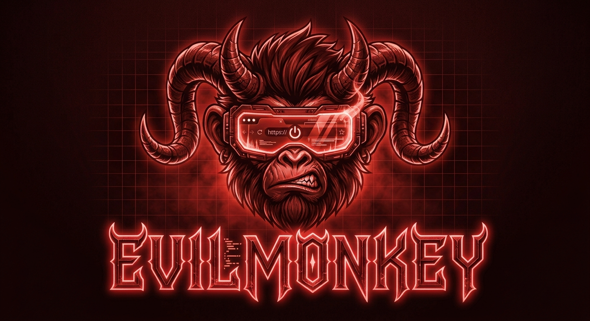

# EvilMonkey

<p align="center">
  
</p>

<p align="center"><strong>Cast Curses on the web.</strong></p>

EvilMonkey is a Chrome-first userscript manager with an AI agent that investigates websites, creates and repairs userscripts, and checks its work against the live page. EvilMonkey calls userscripts **Curses**.

The goal is to let you ask for a change in plain language—such as hiding sponsored posts or adding a useful control—then inspect the evidence, test results, code, and permissions before choosing to install it.

## Project Status

EvilMonkey is in planning and early development. This repository contains the product specification, implementation plan, and a Violentmonkey source baseline. The agent workspace, browser investigation tools, and end-to-end generation and testing workflow are planned; they are not yet a finished EvilMonkey release.

The implementation builds on Violentmonkey so existing userscript behavior and supported GM APIs can be preserved. The first target is Chrome with Manifest V3. Other browsers may be considered later.

## How It Is Intended to Work

1. Describe what you want a website to do.
2. EvilMonkey investigates the selected tab and gathers relevant browser evidence.
3. An agent drafts a Curse and proposes observable checks.
4. You authorize a bounded test and review the evidence, results, code diff, matched sites, and requested permissions.
5. You approve the exact revision before EvilMonkey installs it.

Agent use will be optional. The existing userscript manager should remain useful without an AI connection.

## Agent Support Roadmap

- **Claude Code**: first external MCP and embedded-session integration.
- **OpenAI Codex**: follow-on external MCP and embedded-session integration.
- **Anthropic API and OpenAI API**: later, separately configured backends with clear billing and credential handling.

Connecting an external MCP client and running an agent session inside the extension are separate capabilities. The implementation plan tracks them separately and calls for verifying each provider's supported integration before choosing a transport.

## Documentation

- [Product and implementation specification](docs/EvilMonkey-Specification.md)
- [Chrome-first extension build plan](docs/evilmonkey-extension-plan.md)
- [Quest planning guide](docs/quest-planning-guide.md)
- [Violentmonkey development notes](violentmonkey/DEVELOPMENT.md)

## Chrome Development

The extension source is in [`violentmonkey/`](violentmonkey/). Its existing build pipeline includes a Chrome Manifest V3 target.

### Requirements

- Node.js 24 or newer
- pnpm 12.4.2, as specified by the source package
- Chrome for loading and trying the unpacked build

### Build and run

From the `violentmonkey/` directory:

```sh
pnpm install
pnpm dev:mv3
```

For a production build, run:

```sh
pnpm build:mv3
```

The MV3 build is written to `violentmonkey/dist-mv3/`. In Chrome, open `chrome://extensions`, enable Developer mode, choose **Load unpacked**, and select that directory. The current upstream `userScripts` flow may also require enabling Chrome's **Allow User Scripts** setting for the extension.

The commands above build the current Violentmonkey baseline. They do not imply that the planned EvilMonkey agent features are already available.

## Product Vocabulary

| Term | Meaning |
|---|---|
| **Curse** | A userscript |
| **Conjure** | Create or revise a Curse |
| **Cast** | Enable a Curse |
| **Grimoire** | The userscript library |

Security, permissions, and diagnostics will use direct technical language so users can understand what they are approving.

## Design Principles

- **Evidence before claims:** distinguish observed page facts from an agent's interpretation.
- **Review before install:** show the exact code revision, scope, grants, tests, and limitations.
- **Bounded access:** keep agent activity scoped to the selected tab by default, and ask before expanding scope or performing consequential actions.
- **Honest capabilities:** report unsupported browser tools and missing evidence instead of implying they ran.
- **Preserve the foundation:** extend the existing userscript engine and MCP integration instead of duplicating their responsibilities.

## License and Upstream

EvilMonkey is being developed from the [Violentmonkey](https://github.com/violentmonkey/violentmonkey) source baseline. See the source tree's license and project documentation for upstream terms and attribution.
