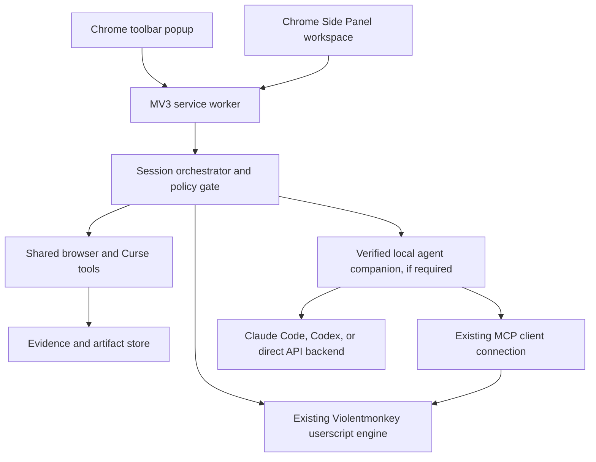
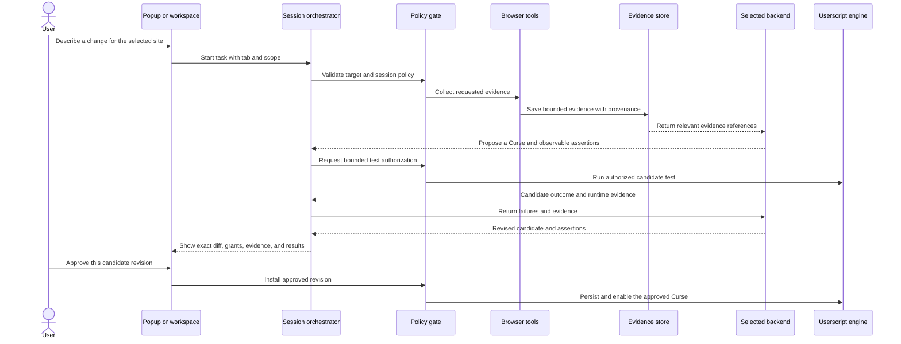
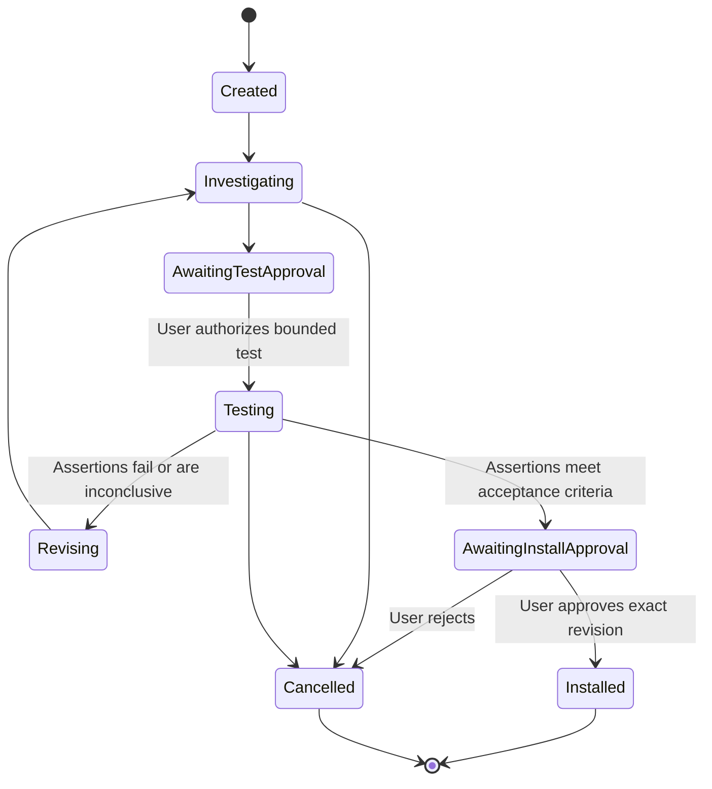

# EvilMonkey Extension Build Plan

Status: Planning draft  
Primary browser: Chrome (Manifest V3)  
Source baseline: Violentmonkey commit `de690ecdf923dc444f402b91c1c7d8edd471f31a`

## Overview

EvilMonkey extends the existing Violentmonkey userscript manager with an in-extension agent workflow. A user describes a website change, the agent investigates the currently selected page, drafts a Curse (userscript), tests it against observable behavior, and presents the exact code and permissions for approval before installation.

The product must remain useful as a normal userscript manager when no AI backend is connected. Chrome MV3 is the initial delivery target. Keep browser-specific integration behind a small boundary so a future port is possible, but do not make cross-browser support a release requirement for the first version.

### Product goals

- Preserve Violentmonkey script storage, metadata, execution, supported GM APIs, import/export, and ordinary management workflows.
- Reuse the existing Violentmonkey MCP integration for external agents rather than creating a competing script-management protocol.
- Add a persistent Chrome extension workspace for the agent session, evidence, code review, approvals, and recovery.
- Give the agent structured access to the selected tab and report which browser capabilities were available.
- Test candidate Curses using observable assertions; do not call a script successful based only on code generation or a clean console.
- Make permissions, origin scope, data sent to a provider, and state-changing actions visible and enforceable.

### Scope

| In scope for the Chrome product | Deferred or excluded from the first release |
|---|---|
| Chrome MV3 build and installation workflow | Firefox, Safari, Edge-specific UX and packaging |
| Existing userscript management and MCP compatibility | Replacing the upstream userscript engine or GM APIs |
| Persistent workspace and a complete Claude Code vertical slice | Arbitrary unrestricted page JavaScript as the only browser tool |
| Codex integration and direct API backends in planned follow-on phases | Treating an external MCP connection as an embedded agent session |
| Browser evidence, bounded testing, review, and install approval | Claiming unsupported DevTools or Lighthouse capabilities |

### Success criteria

- Existing Curses continue to run and remain manageable without an AI connection.
- An external MCP client can still list, read, write, enable, disable, and delete scripts through the upstream-compatible flow.
- A user can start a scoped task from the extension, close the popup, reopen the workspace, and recover the persisted session view.
- The agent can investigate a live Chrome tab, produce a candidate Curse, run approved tests, and show results tied to evidence.
- Installation requires approval of the exact candidate revision, match patterns, grants, and test report.
- Unsupported capabilities return an explicit status and reason.

## Verified Starting Point

The repository contains a Violentmonkey source checkout plus the EvilMonkey specification and planning template. The source checkout identifies itself as Violentmonkey `2.49.0`; its current revision is recorded above. This is an initial source survey, not the required complete Phase 0 audit.

| Capability | Current evidence | Planning implication |
|---|---|---|
| Chrome MV3 build | `violentmonkey/package.json` defines `build:mv3`; `violentmonkey/scripts/manifest-helper.js` generates a Manifest V3 service worker manifest, currently with a Chrome minimum of 135 and `<all_urls>` host access | Build on this path and verify its assumptions before adding agent components; audit whether new agent features can avoid expanding or can narrow current host access |
| Userscript execution | `violentmonkey/src/common/browser-scripts-api.js` and `violentmonkey/src/background/utils/preinject-core.js` use `chrome.userScripts` for MV3 execution and registration | Preserve this engine and test the candidate-run lifecycle against its actual isolation and permission behavior |
| Existing MCP client | `violentmonkey/src/background/utils/mcp.js` uses `@violentmonkey/mcp-client`, listens for an authorization URL, and requests approval in settings | Keep this connection flow compatible; do not mistake it for an MCP server implementation or an agent-session backend |
| Script management tools | `mcp.js` registers `scripts_list`, `scripts_get`, `scripts_write`, `scripts_set_enabled`, and `scripts_delete` | Phase 0 must compare the packaged upstream MCP server's schemas and lifecycle with these extension handlers |
| MCP connection lifecycle | Connection state, pending approval, and disconnect are held in module memory in `mcp.js` | Verify behavior through browser restart and service-worker suspension; preserve documented reconnect semantics unless intentionally redesigned |
| Settings UI | `violentmonkey/src/options/views/tab-settings/vm-mcp.vue` exposes pending approval, connection state, and disconnect | Reuse its approval semantics and localization patterns where appropriate |
| Long-lived workspace | No Side Panel manifest key or `sidePanel` permission appears in `violentmonkey/scripts/manifest-helper.js` | Add and verify Chrome Side Panel support, or document a workspace-page fallback |
| Browser inspection | No agent browser-inspection or verification subsystem is present in the surveyed extension files | Design and build this as a new capability behind a scoped tool contract |
| Agent session backends | `violentmonkey/package.json` includes `@violentmonkey/mcp-client`, not a Claude Code or Codex session runtime | Verify official integration options and companion requirements before selecting a backend architecture |
| Chrome debugger | The generated permissions do not include `debugger` | Debugger-backed capabilities need an explicit permission and product decision; baseline DOM inspection should not imply full DevTools access |

Chrome's current documentation identifies `chrome.sidePanel` as an MV3 API available since Chrome 114 and `chrome.userScripts` as available in MV3 starting with Chrome 120, with a user-controlled setting required to enable user scripts. The current source's Chrome 135 minimum is therefore a project/build constraint that must be traced to its specific API usage, rather than assumed to be the platform minimum. Chrome documents `chrome.debugger` as restricted to a subset of CDP domains, and its `debugger` permission cannot be requested as an optional permission. See [Side Panel API](https://developer.chrome.com/docs/extensions/reference/api/sidePanel), [User Scripts API](https://developer.chrome.com/docs/extensions/reference/api/userScripts), [Debugger API](https://developer.chrome.com/docs/extensions/reference/api/debugger), and [Permissions API](https://developer.chrome.com/docs/extensions/reference/api/permissions).

## Architecture

This is a logical map, not a final transport topology. Phase 0 must choose how the workspace reaches the session orchestrator and how embedded backends reach their supported runtime. The browser tools and policy checks must have one shared implementation so external MCP and embedded backends cannot gain different access rules.

### Component responsibilities

| Component | Responsibility | Does not handle |
|---|---|---|
| Popup | Show current site, related Curses, prompt, connection state, progress, and workspace entry point | Own session lifetime or store the only copy of task state |
| Side Panel workspace | Host conversation, tool timeline, evidence, candidate editor/diff, approvals, and recovery UI | Execute a second independent version of browser tools |
| Session orchestrator | Own session state, target, budgets, checkpoints, cancellation, and backend-neutral events | Trust model instructions to enforce permission or scope rules |
| Policy gate | Enforce origin/tab/frame scope, tool risk, approvals, redaction, and exact-revision install | Delegate authorization to the provider or generated Curse |
| Browser tool service | Gather structured evidence and perform explicitly authorized page interactions | Claim inaccessible or unsupported DevTools capability |
| Evidence store | Save bounded facts and artifacts with target, time, provenance, document epoch, and limitations | Treat page content as trusted instructions or preserve stale live handles |
| Curse test runner | Execute an authorized candidate in a bounded test lifecycle and evaluate assertions | Install persistently or imply tests are isolated from account/server effects |
| Existing VM engine | Retain script metadata, storage, injection, GM APIs, and script lifecycle | Be replaced by extension `eval` or a newly invented sandbox |
| Existing MCP integration | Preserve upstream agent-to-script management access and approval flow | Launch Claude Code/Codex sessions or provide all new browser tools by itself |
| Agent backend adapter | Translate verified backend events, questions, approvals, failures, cancellation, and completion | Normalize unsupported abilities into fabricated success |
| Local companion | Provide native process/session integration if the selected backend requires it | Reimplement browser tools or expose an unauthenticated local control port |

### Runtime boundaries

- Use Chrome MV3 APIs for the first release and isolate their use behind browser services where a later browser port benefits from it.
- Keep session orchestration independent of popup lifetime and service-worker memory. Persist recoverable session state and treat live target handles as disposable.
- Use Chrome's Side Panel for the persistent workspace if the audit confirms it fits the current build and supported minimum Chrome version. Keep an extension page as a fallback if needed.
- Reuse existing database, storage, options, messaging, and script services where they fit. Record any new persistent data separately from the current script schema until migration needs are understood.
- Keep browser tool execution in the extension's privileged contexts. Curses and page code must not receive MCP connection credentials, provider credentials, or debugger control.

### Browser capability policy

The requested DevTools coverage is a roadmap, not a promise that every capability can be exposed through a Chrome extension. Probe capabilities per target and report availability at session start.

| Area | First useful implementation | Constraints to verify |
|---|---|---|
| Elements | Structured DOM, accessibility-relevant attributes, semantic ancestors, repeated siblings, selector candidates, mutation tracking | Cross-origin frames, closed shadow roots, content restrictions, and stale references |
| Console/runtime | Bounded logs and exceptions; constrained evaluation only when justified | Evaluation scope, output limits, and page side effects |
| Sources | Loaded script inventory and targeted search where supported | Source maps, access limits, and payload redaction |
| Network | Opt-in, bounded request metadata and selected response details | `debugger` permission decision, body availability, sensitive data, and detach behavior |
| Performance | Page timing and bounded measurements before/after a candidate | Measurement overhead and attribution limits |
| Memory | DOM growth and lightweight measures first | Heap profiling support and permission/tooling limits |
| Application/security | Narrow, user-requested inspection | Sensitive storage, credentials, inaccessible domains, and misleading coverage |
| Lighthouse/Recorder | Separate researched integration only | Do not label protocol Audits as Lighthouse or claim flow recording without tested replay and assertions |

Every tool contract includes typed input/output, target and scope, permission needs, side-effect level, timeout/cancellation behavior, output budget, pagination, redaction, evidence references, and structured unsupported/error results.

## Data Flow and Lifecycles

### Agent task flow

### Session state

The UI must distinguish a resumable transcript/checkpoint from invalid live handles after navigation, browser restart, target closure, or debugger detachment. Cancellation stops supported agent work and collection; it cannot recall a request or undo an external action already completed.

### Evidence record

| Field | Meaning |
|---|---|
| Evidence ID | Stable identifier for one fact or artifact |
| Session and target | Session, tab, frame, origin, and capture time |
| Document epoch | Navigation/SPA epoch that determines whether references remain valid |
| Kind and summary | Concise classification and human-readable observation |
| Payload reference | Bounded structured fact or artifact pointer |
| Provenance | Tool, parameters that matter, and capture timestamp |
| Limitations | Missing data, unavailable capability, and collection boundaries |
| Sensitivity | Redaction and model-transmission decision |

Store large snapshots, traces, and response bodies as bounded artifacts. Present targeted evidence first, redact secrets before provider transmission, and invalidate node/handle references after the associated document epoch changes.

## Decision Gates

Phase 0 must resolve these questions before architecture is treated as final:

| Decision | Evidence needed | Default planning position |
|---|---|---|
| Which exact upstream MCP server release and source are supported? | Inspect its source, tool schemas, pairing flow, token lifecycle, and browser message routing | Reuse it; do not fork its pairing or CRUD layer without a documented gap |
| How does the extension host embedded Claude Code and Codex sessions? | Current official integration docs, supported event/approval APIs, process lifecycle, authentication, cancellation, and platform support | Use a local companion only if a supported integration requires native process/session access |
| Which UI surface hosts long sessions? | Side Panel support in build pipeline, target Chrome version, workspace lifecycle, and navigation behavior | Chrome Side Panel, with extension page fallback if build constraints require it |
| Is the Chrome `debugger` permission acceptable? | Permission warning, required tools, detach behavior, enterprise restrictions, and user value | Ship the basic DOM/console slice without it until the debugger-backed feature set justifies the permission |
| How are candidates tested safely? | Actual MV3 `userScripts` execution worlds, registration/cleanup semantics, target reload behavior, and effects on authenticated pages | Separate temporary test authorization from persistent install; never describe a live account tab as isolated |
| How is session state persisted? | Existing DB/storage patterns, service-worker wake behavior, privacy/retention requirements | Persist minimal transcript/checkpoint metadata; do not persist live browser handles or silently preserve upstream tokens |
| What is the supported Chrome minimum? | Trace the current Chrome 135 build floor to the APIs in use and add the new Side Panel requirements | Keep current floor until evidence supports changing it |

Record each decision, alternatives, consequences, and a revisit trigger in the Phase 0 audit. A direct API backend must be presented separately from Claude Code or Codex access and billing.

## Implementation Phases

### Phase 0: Source and Integration Audit

**Objective**: Produce the required source-backed gap analysis and architecture decisions before adding agent architecture.

**Dependencies**: Current Violentmonkey source baseline and the specification.

**Changes**:
- Pin the exact Violentmonkey commit and inspect the extension, MCP client, packaged upstream MCP server, and current official provider documentation.
- Inventory current MCP tools, schemas, message routing, connection approval, token handling, restart behavior, injection, storage, GM APIs, and browser build targets.
- Classify each relevant feature as upstream complete, upstream requiring extension work, or new.
- Trace Chrome MV3 service-worker lifecycle, Chrome 135 build floor, `userScripts` requirements, Side Panel integration, and available browser tool surfaces.
- Decide agent backend transport and companion requirements from documented capabilities, not assumptions.
- Record architecture decisions, security boundaries, distribution assumptions, and unresolved risks.

**Acceptance criteria**:
- [x] Gap analysis names source files and the exact source revision.
- [x] MCP server and extension MCP client responsibilities are clearly separated.
- [x] Claude Code and Codex embedded-session integration paths are backed by current official documentation.
- [x] Chrome tool capability matrix identifies permissions, limitations, and viable fallbacks.
- [x] Architecture decisions list alternatives and explain unresolved items.

Completed deliverable: `docs/phase-0-audit.md` (with review corrections applied).

### Phase 1: Chrome Workspace and Shared Session Foundation

**Objective**: Establish persistent Chrome-first UX and backend-neutral session orchestration without disrupting ordinary script management.

**Dependencies**: Phase 0 architecture decisions.

**Changes**:
- Add the Side Panel workspace and popup entry point using existing Vue/UI and extension build conventions.
- Define the session, target, event, evidence-reference, artifact, and candidate-revision models.
- Add persisted checkpoints, budgets, stop behavior, and recovery states that tolerate MV3 worker suspension.
- Implement a policy gate for selected-tab scope, origin changes, tool risk levels, redaction, and exact-revision approval.
- Preserve the existing MCP settings approval and explicit disconnect flow.

**Acceptance criteria**:
- [ ] The workspace survives popup closure and worker suspension with a clear recoverable/unrecoverable session state.
- [ ] Session scope defaults to the selected tab and reports navigation or target changes.
- [ ] Users can stop an active task and see which operations could not be recalled.
- [ ] Existing script management works without configuring an agent backend.
- [x] No agent or browser tool can bypass the shared policy gate.

Phase 1 deliverable notes: `docs/phase-1-notes.md`. The first four criteria need
live Chrome verification (no interactive browser was available); the last is
verified by code inspection of the single gated dispatch path.

### Phase 2: Browser Evidence and Investigation Tools

**Objective**: Give the first agent workflow reliable, bounded evidence from the selected Chrome page.

**Dependencies**: Phase 1 target model and policy gate.

**Changes**:
- Implement capability discovery, selected-tab/frame targeting, document epochs, and route-change tracking.
- Add structured DOM inspection, user-picked element context, repeated-item detection, selector proposals, and selector validation.
- Add bounded console/error collection and mutation observation.
- Add evidence provenance, artifact limits, pagination, stale-reference handling, and redaction before model transmission.
- Return explicit unsupported statuses for tools outside the implemented capability matrix.

**Acceptance criteria**:
- [x] A tool result identifies target tab/frame, document epoch, provenance, warnings, limitations, and any next-page cursor. (Verified by code inspection: the single `envelope()` result path in `src/background/evm/evidence.js` always emits every required field; see docs/phase-2-notes.md.)
- [ ] Selector candidates include observed match count and validation status; stale candidates fail clearly after navigation. (Needs live Chrome: snapshot, propose, navigate, re-run with the old epoch.)
- [x] Page content is treated as untrusted evidence rather than tool policy or agent instructions. (Verified by code inspection: `provenance.untrusted: true` on every result, redaction boundary, policy gate never reads page content.)
- [x] Collection limits and redaction are enforced before evidence reaches a provider. (Verified by code inspection: hard caps in collectors and walker, `redactForProvider` on every payload. Known limitation: value-embedded secrets under innocuous keys are not caught.)
- [x] The session start report distinguishes available, unavailable, and not-yet-instrumented capabilities. (Verified by code inspection: `EvmSessionCreate` attaches the three-way summary to the session-created event.)

Phase 2 deliverable: `docs/phase-2-notes.md` (tool inventory, design choices, validation, live-test list).

### Phase 3: Curse Draft, Bounded Test, and Approval Vertical Slice

**Objective**: Complete one evidence-based request end to end using the existing userscript engine.

**Dependencies**: Phases 1 and 2; verified MV3 userscript lifecycle.

**Changes**:
- Define candidate Curse metadata, match patterns, grants, revision identity, and observable assertions.
- Implement an explicit test authorization step separate from persistent installation.
- Test a candidate against the selected page using cleanup where possible and report effects that cannot be rolled back.
- Show a diff, metadata, grants, matched sites, external destinations, assertions, evidence, and limitations before installation.
- Bind install approval to the exact candidate revision and invalidate approval when code or metadata changes.

**Acceptance criteria**:
- [ ] A representative task such as hiding sponsored feed cards tests both target and ordinary cards, dynamic additions, and duplicate observer behavior.
- [ ] Each assertion reports PASS, FAIL, NOT_RUN, or INCONCLUSIVE with evidence and test conditions.
- [ ] A failed assertion feeds evidence back into a revision cycle and demonstrates at least one repair.
- [x] Installation is impossible without approval of the currently displayed revision and permissions.
- [x] Reload, cleanup, and irreversible page/server effects are explained accurately.

Phase 3 implementation is complete and build-verified; see
`docs/phase-3-notes.md`. The two checked criteria were verified by code
inspection (`EvmCurseInstall` enforces `checkInstallApproval` and throws
`install-refused` otherwise; reload/cleanup/irreversible semantics are
implemented in the runner and stated in the UI and notes). The remaining
three need live Chrome testing; the notes doc gives the exact procedure.

### Phase 4: Claude Code Backend

**Objective**: Deliver the first supported external and embedded Claude Code workflows.

**Dependencies**: Phase 0 verified Claude integration; Phases 1–3.

**Changes**:
- Keep external Claude Code MCP use compatible with the verified upstream server and extension connection flow.
- Implement the embedded session adapter only through a currently supported Claude Code integration.
- Normalize messages, tool activity, questions/approvals, errors, cancellation, completion, and recoverable session identifiers.
- Clearly separate Claude Code authentication from Anthropic API key configuration.

**Acceptance criteria**:
- [ ] External Claude Code can manage Curses without a duplicate CRUD or pairing implementation.
- [ ] The extension can start and continue an embedded Claude Code-backed task using supported user authentication.
- [ ] The workspace displays progress, tool events, questions, errors, stop state, and recovery status without exposing hidden reasoning.
- [ ] Provider unavailability or unsupported integration paths fail visibly without switching to paid API use.
- [ ] Browser policy and approvals remain enforced for both external and embedded access.

### Phase 5: Codex Backend

**Objective**: Add Codex as a second agent backend while retaining the same browser tools and policy rules.

**Dependencies**: Phase 4 adapter contract and current official Codex integration research.

**Changes**:
- Verify current Codex MCP configuration separately from embedded app-server/SDK capabilities.
- Add external MCP configuration guidance using the current supported Codex mechanism.
- Add a Codex embedded adapter only for verified session/event/authentication capabilities.
- Test session resume, approval, cancellation, and backend switching.

**Acceptance criteria**:
- [ ] Codex external MCP access works against the shared tool surface.
- [ ] Codex embedded sessions support the same user-visible event and recovery states that the verified interface provides.
- [ ] Selecting Codex does not change origin scope, data redaction, browser permissions, or installation approval.
- [ ] Codex access and OpenAI API billing are described as distinct choices.

### Phase 6: Direct API Backends

**Objective**: Add Anthropic API and OpenAI API as explicit, separately configured choices.

**Dependencies**: Stable backend contract, credential storage design, usage/cost display, and provider documentation.

**Changes**:
- Add backend adapters with user-supplied credentials and supported model selection.
- Keep provider credentials in privileged extension/companion contexts and unavailable to Curses, webpage code, and ordinary tool results.
- Add clear usage, billing, rate-limit, cancellation, and error handling where providers expose the information.
- Do not infer API entitlement from a Claude Code or Codex subscription.

**Acceptance criteria**:
- [ ] Users can distinguish API-backed sessions from CLI/product-backed sessions before starting work.
- [ ] Credentials are not exposed to page scripts, Curses, browser evidence, or ordinary logs.
- [ ] Backend failures never silently switch provider or incur different costs.
- [ ] Usage is shown when available and marked unavailable when not exposed by the provider.

### Parallel Track: Advanced Chrome Investigation

**Objective**: Expand evidence capabilities based on tested Chrome API support and explicit permission decisions.

**Dependencies**: Phases 0–3; approval of any permission or companion changes.

**Changes**:
- Evaluate debugger-backed network, sources, runtime, performance, frame, and worker inspection.
- Document debugger attach/detach behavior, interaction with DevTools, enterprise policy restrictions, and the user-facing permission warning.
- Add bounded action-to-DOM/network/error correlation, dynamic-content investigation, and before/after comparisons.
- Research separate supported integrations for heap profiling, Lighthouse, and record/replay where the extension API is insufficient.

**Acceptance criteria**:
- [ ] Every capability is tested against supported Chrome versions and reports its limitations.
- [ ] Debugger-backed behavior handles detach, target closure, navigation, and existing DevTools interaction.
- [ ] No protocol Audits report is labeled Lighthouse.
- [ ] Network/body capture is opt-in, bounded, redacted, and provenance-linked.
- [ ] Unsupported capability calls return structured errors without a broader fallback.

### Phase 7: Chrome Packaging and Release Readiness

**Objective**: Package, document, and support the first Chrome release.

**Dependencies**: Required product phases and reviewed permission model.

**Changes**:
- Define Chrome development installation, production distribution, upgrade, and rollback procedures.
- Update onboarding, backend connection guidance, permission explanations, privacy disclosures, and troubleshooting.
- Verify minimum Chrome version, userScripts enablement instructions, Side Panel behavior, and debugger permission decision.
- Add representative end-to-end scenarios to the existing extension test/build workflow.
- Record a browser-port boundary document identifying Chrome-only APIs and intentionally deferred port work.

**Acceptance criteria**:
- [ ] A clean Chrome profile can install, configure, use, upgrade, and remove the extension using documented steps.
- [ ] No-AI userscript management remains usable after install and during backend outages.
- [ ] Session recovery, stop, reconnect, permissions, approval, and data retention behavior are documented and verified.
- [ ] Chrome-specific APIs are isolated enough to make future port assessment possible without claiming other-browser support.

## Verification Strategy

Verification follows the existing repo's test/build conventions; each phase should begin with focused unit tests, then extension integration tests, then a real Chrome workflow when it exercises browser APIs.

| Area | Required scenarios | Evidence of completion |
|---|---|---|
| Existing extension | Script install/update/enable/disable/delete, import/export, GM API behavior, no backend configured | Existing suite plus regression cases around changed paths |
| MCP compatibility | Approval, reject, connect, disconnect, tool schemas, restart/reconnect, invalid script writes | Compatibility test against the pinned server version and documented connection lifecycle |
| MV3 lifecycle | Popup closes, worker suspends/restarts, browser restarts, tab closes, route/navigation changes | Recoverable state and invalid handles are distinguished in the UI and tests |
| Browser tools | Main frame, supported subframes, dynamic content, inaccessible page, unsupported capability, large result | Structured evidence records, clear limits, bounded output, and no stale references |
| Curse verification | Positive target, negative control, dynamic elements, idempotency, duplicate UI/listeners, revision changes | Assertion report with evidence and exact approved revision |
| Security | Prompt injection in page text, secret-like values, origin expansion, external navigation, dangerous interactions | Policy-denial and redaction evidence; no provider or page bypass |
| Agent adapters | Authentication failure, backend disconnect, question/approval, cancellation, resume, provider switch | Normalized event sequence with no hidden-reasoning or silent-cost behavior |
| Performance and retention | Large DOM, repeated mutation, capture limits, abandoned sessions, artifact expiry | Bounded work and documented retention behavior |

### Test interaction safety

- Keep automated tests on controlled fixtures or deliberately prepared test pages whenever possible.
- Treat a real signed-in browser tab as a live account, not a sandbox.
- Do not replay purchases, submissions, destructive actions, or state-changing requests without a separate explicit approval.
- Report test conditions, missing baselines, and inconclusive outcomes. A clean console alone is not acceptance.

## Security, Privacy, and User Control

- Treat all website text, scripts, network responses, and existing Curses as untrusted inputs.
- Enforce target scope, approvals, output limits, redaction, and install-revision binding in extension code.
- Default to the selected tab/site; require approval to expand origin or target scope.
- Do not transmit cookies, authorization headers, complete storage contents, or unrelated page text by default.
- Keep provider credentials, MCP tokens, and debugger capabilities away from Curses and page execution contexts.
- Keep an action/evidence timeline and a visible stop control in the persistent workspace.
- Require separate authorization for temporary execution and persistent installation.
- Make clear that disabling a Curse stops future execution but may not reverse page changes, network effects, downloads, or server-side actions.
- Bound agent turns, runtime, evidence volume, response-body capture, artifact retention, and paid API usage.

## Risks and Mitigations

| Risk | Impact | Mitigation |
|---|---|---|
| Rebuilding upstream MCP management | Divergent schemas, duplicate approval, and breakage | Audit the pinned MCP server and extend existing routes/tools only where a measured gap exists |
| Confusing MCP tools with embedded agent sessions | A working external client is mistaken for in-extension backend support | Track external and embedded workflows as separate acceptance items and adapters |
| MV3 worker suspension | Lost in-memory task state and orphaned sessions | Persist checkpoints; make live browser handles renewable and popup-independent |
| Chrome debugger permission | Significant warning and broad debugging authority | Start with a no-debugger vertical slice; make permission a reviewed, explicit phase gate |
| Browser capability overstatement | Users trust tests or evidence that were never collected | Capability matrix, provenance, structured unsupported results, and clear limitations |
| Candidate testing affects real accounts | Irreversible page or server-side changes | Separate test/install approval and require specific approval for high-impact actions |
| Sensitive evidence reaches a provider | Account or personal data exposure | Minimize, redact, preview, bound, and obtain informed backend selection |
| Userscript sandbox assumptions are wrong | Privilege leakage or broken compatibility | Verify actual Chrome `userScripts` worlds and upstream lifecycle before test-runner design |
| Scope grows before a working product slice | Long delay before users can complete one task | Deliver the Phase 3 vertical slice before broad DevTools or provider expansion |
| Future portability shapes Chrome UX prematurely | Chrome release is burdened by unused abstractions | Isolate browser API seams only where useful; defer other-browser implementation |

## Requirement Traceability

| Specification requirement | Plan section | Validation |
|---|---|---|
| Preserve Violentmonkey and GM compatibility | Verified Starting Point; Phases 1 and 7 | Existing extension regression suite |
| Reuse upstream MCP and avoid duplicate pairing/CRUD | Verified Starting Point; Phase 0; Phase 4 | Pinned-server compatibility test |
| Claude Code first, then Codex, then direct APIs | Phases 4–6 | Backend acceptance criteria |
| Embedded UI and persistent sessions | Architecture; Phases 1 and 7 | Worker suspension and popup-close scenarios |
| Structured browser investigation | Capability policy; Phase 2; advanced track | Capability matrix and evidence records |
| Candidate test, repair, review, exact install approval | Phases 3–4 | Representative task plus revision-bound approval tests |
| Chrome-first, possible future browser ports | Overview; Runtime boundaries; Phase 7 | Chrome release criteria and port-boundary note |
| Security, privacy, budgets, and honest limitations | Security; Risks; verification strategy | Policy, redaction, scope, cancellation, and retention cases |

## References and Assumptions

### Local project documents

- [Product and Implementation Specification](./EvilMonkey-Specification.md)
- [Quest Planning Guide](./quest-planning-guide.md)
- [Violentmonkey development notes](../violentmonkey/DEVELOPMENT.md)
- [Generated manifest logic](../violentmonkey/scripts/manifest-helper.js)
- [Existing MCP client and script tools](../violentmonkey/src/background/utils/mcp.js)
- [Existing MCP approval UI](../violentmonkey/src/options/views/tab-settings/vm-mcp.vue)
- [Chrome userscript execution adapter](../violentmonkey/src/common/browser-scripts-api.js)

### Official platform and provider documentation

- [Chrome Side Panel API](https://developer.chrome.com/docs/extensions/reference/api/sidePanel)
- [Chrome User Scripts API](https://developer.chrome.com/docs/extensions/reference/api/userScripts)
- [Chrome Debugger API](https://developer.chrome.com/docs/extensions/reference/api/debugger)
- [Chrome Permissions API](https://developer.chrome.com/docs/extensions/reference/api/permissions)
- [Claude Code CLI and session documentation](https://docs.anthropic.com/en/docs/claude-code/cli-usage)
- [Anthropic MCP documentation](https://docs.anthropic.com/en/docs/mcp)
- [Codex app-server documentation](https://developers.openai.com/siwc/token-sharing-open-source/codex-app-server)
- [OpenAI Codex documentation](https://developers.openai.com/learn/codex)

Provider and Chrome documentation changes over time. Recheck the official docs during Phase 0 and record the verification date and supported versions before implementation decisions become binding.
