# Quest Planning Guide
## How to Create High-Quality Technical Design Documents

## Overview

This guide provides a comprehensive, **project-agnostic** framework for creating structured technical design documents that transform feature ideas into actionable, well-architected implementation plans. These documents serve as the strategic blueprint that bridges high-level requirements with detailed technical execution, ensuring alignment between stakeholders, maintainability, and implementation clarity.

**Purpose**: Enable technical teams across **any software project** to create consistent, thorough design documents that:
- Capture complete system context and problem scope
- Define clear architectural boundaries and component interactions
- Establish data flow patterns and state management strategies
- Specify validation criteria and testing strategies
- Document decision rationale and trade-off analysis
- Maintain quality through automated validation

**Target Audience**: Technical architects, senior engineers, and design reviewers working on complex system features in web applications, backend services, mobile apps, embedded systems, or any software engineering domain

**Reusability**: All templates, diagrams, and checklists in this guide are designed to be **copy-paste ready** and adaptable to your project's specific technology stack and domain

## Document Anatomy

### Core Structural Components

Every design document follows a hierarchical structure optimized for both human comprehension and implementation reference:

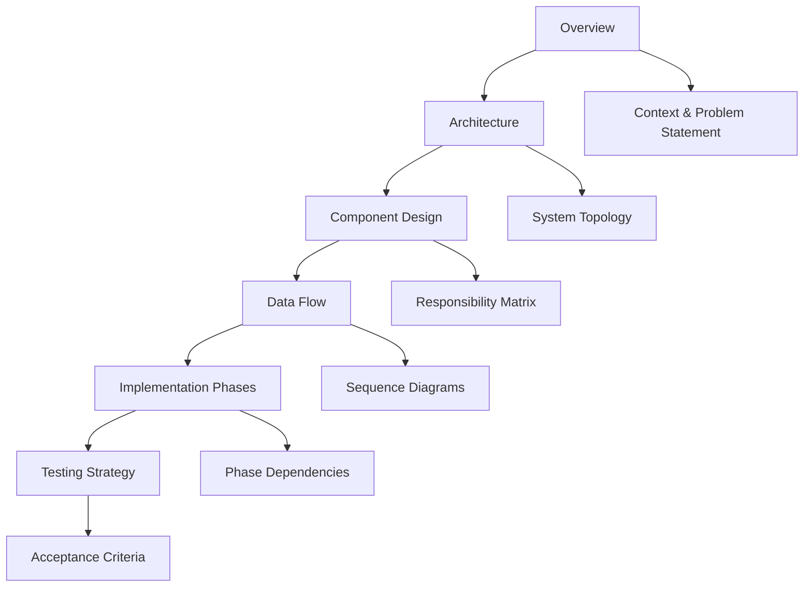

**Universal Applicability**: This structure works for:
- Backend API development (services, databases, message queues)
- Frontend applications (React, Vue, Angular, mobile apps)
- Infrastructure changes (CI/CD, deployment, monitoring)
- Data pipelines (ETL, streaming, batch processing)
- Embedded systems (firmware, device drivers)
- Library/framework development

### Mandatory Sections

| Section | Purpose | Content Type |
|---------|---------|--------------|
| **Overview** | Problem definition, scope boundaries, strategic context | Natural language, context tables |
| **Architecture** | System structure, component relationships, design patterns | Mermaid diagrams, responsibility matrices |
| **Data Flow** | Information movement, state transitions, event sequences | Sequence diagrams, state machines |
| **Implementation Phases** | Dependency-ordered execution plan with validation gates | Phase tables, acceptance checklists |
| **Testing Strategy** | Validation approach, test matrices, coverage criteria | Test case tables, scenario descriptions |

### Optional But Recommended Sections

| Section | When to Include | Example Domains |
|---------|----------------|------------------|
| **Historical Context** | For features building on existing infrastructure | Legacy system migrations, API versioning |
| **Migration Strategy** | When replacing or extending existing systems | Database schema changes, framework upgrades |
| **Performance Assessment** | For real-time, high-throughput, or latency-sensitive features | Audio processing, financial trading, gaming engines |
| **Error Handling Strategy** | When failure modes are complex or critical | Payment systems, distributed transactions |
| **Observability** | For runtime systems requiring diagnostics/telemetry | Microservices, cloud infrastructure, production services |
| **Risk Assessment** | When architectural decisions carry significant trade-offs | Greenfield projects, technology migrations |
| **Security Considerations** | For authentication, authorization, or sensitive data handling | User management, payment processing, healthcare systems |
| **Scalability Analysis** | For systems expecting growth or variable load | SaaS platforms, public APIs, content delivery |

## Writing Principles

### 1. Abstraction Level Management

**Strategic Design Focus**: Documents must remain at the architectural abstraction level, describing **what** the system achieves and **why** it is structured that way, never **how** it will be coded.

#### What to Include

- Component responsibilities and boundaries
- Data structure schemas and relationships (database models, API contracts, message formats)
- Interface contracts (REST APIs, GraphQL schemas, gRPC services, function signatures)
- State transition semantics (application state, workflow states, connection states)
- Validation rules and invariants (business rules, data constraints, authorization policies)
- Processing workflows and pipelines (data transformations, event flows, batch jobs)
- Deployment architecture (containers, serverless functions, VM configurations)
- Configuration schemas (environment variables, config files, feature flags)

#### What to Exclude

**NEVER include:**
- Programming language code (no Rust, Python, JavaScript, etc.)
- Configuration file syntax (no YAML, JSON, TOML, etc.)
- SQL statements (no DDL, DML, queries)
- Shell commands or scripts
- Docker/Kubernetes manifests
- Build system configurations

#### Representation Strategies

| Technical Concept | Express Using | Example Domains |
|-------------------|---------------|------------------|
| Data structures | Tables with field names, types, descriptions | Database schemas, API models, in-memory caches |
| Algorithms | Natural language descriptions or pseudocode-style flow | Sorting, search, recommendation engines |
| REST APIs | Endpoint tables with method, path, request/response schemas | Web services, microservices |
| GraphQL APIs | Schema definitions, resolver responsibility tables | Modern web APIs |
| gRPC Services | Service/method tables, protobuf-style message schemas | High-performance RPC systems |
| State machines | Mermaid state diagrams with transition descriptions | UI workflows, connection management, protocol handlers |
| Component interactions | Sequence diagrams, architecture diagrams | Distributed systems, service communication |
| Validation logic | Business rules tables, decision matrices | Form validation, access control, data quality checks |
| Database schemas | Entity-relationship tables, index specifications | SQL/NoSQL database design |
| Event schemas | Event type tables, payload specifications | Event-driven architectures, pub/sub systems |

**Example Patterns**:

**Bad (Language-Specific Code)**:
```
// Don't do this - Rust code
struct ParameterBinding {
    id: String,
    value: f64
}

// Don't do this - Python code
class UserAccount:
    def __init__(self, email: str, balance: Decimal):
        self.email = email
        self.balance = balance

// Don't do this - TypeScript code
interface CartItem {
  productId: string;
  quantity: number;
  price: number;
}
```

**Good (Language-Agnostic Schema)**:
```
User Account Data Structure:

| Field | Type | Constraints | Description |
|-------|------|-------------|-------------|
| email | String | Valid email format, unique | User's email address |
| balance | Decimal | Precision: 2, >= 0 | Account balance in USD |
| created_at | Timestamp | ISO 8601 | Account creation time |
| status | Enum | active, suspended, closed | Account status |
```

**Good (REST API Specification)**:
```
Endpoint: Create Order

| Property | Value |
|----------|-------|
| Method | POST |
| Path | /api/v1/orders |
| Authentication | Bearer token required |

Request Body Schema:

| Field | Type | Required | Description |
|-------|------|----------|-------------|
| items | Array<OrderItem> | Yes | List of items to order |
| shipping_address_id | String (UUID) | Yes | ID of shipping address |
| payment_method_id | String (UUID) | Yes | ID of payment method |

Response (201 Created):

| Field | Type | Description |
|-------|------|-------------|
| order_id | String (UUID) | Unique order identifier |
| total_amount | Decimal | Total order amount |
| estimated_delivery | Date | Estimated delivery date |
```

**Example Diagram Patterns**:

**Generic Microservice Architecture**:
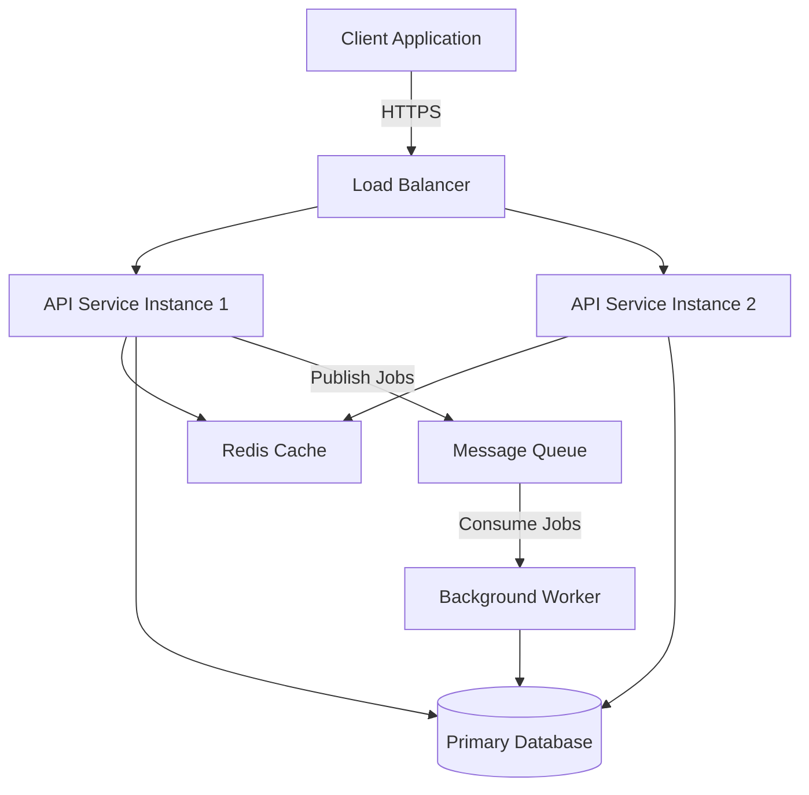

**Generic Authentication Flow**:
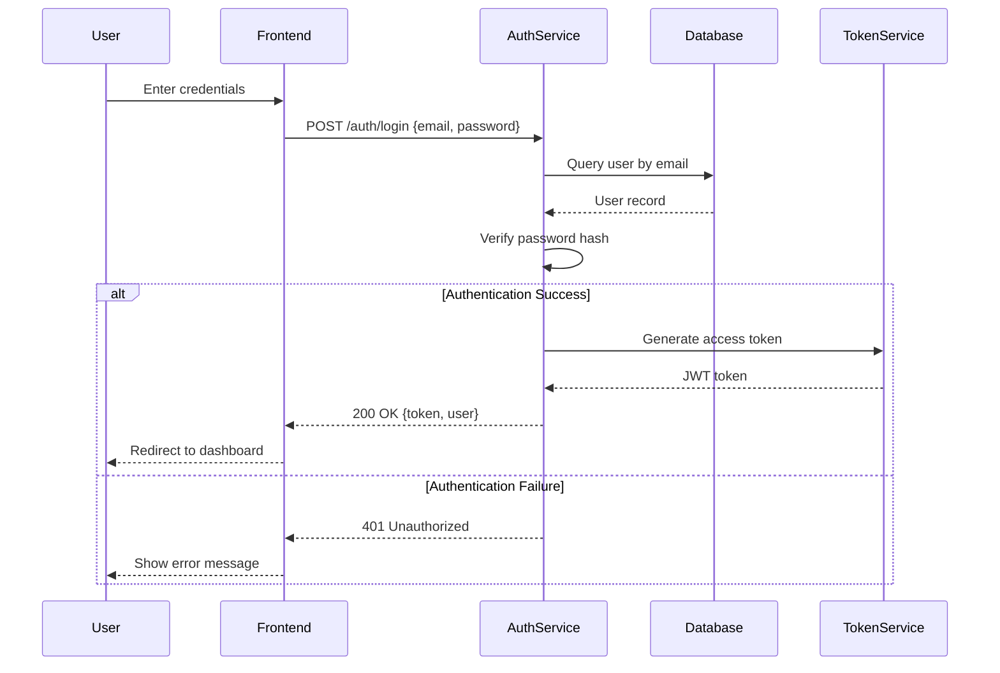

**Generic State Machine (e.g., Order Processing)**:
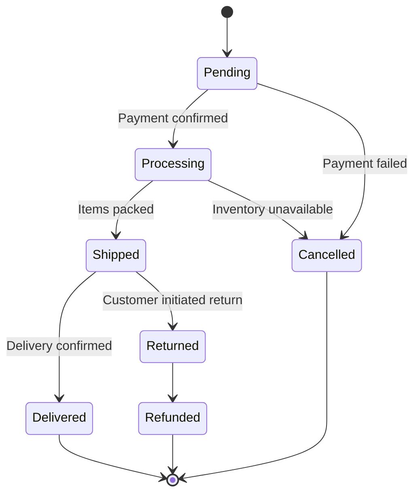

#### Reusable Diagram Templates

**Template 1: Request-Response Flow**
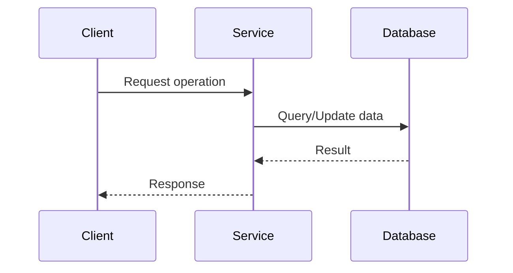
*Customize by: Replacing component names, adding authentication steps, adding error paths*

**Template 2: Event-Driven Architecture**
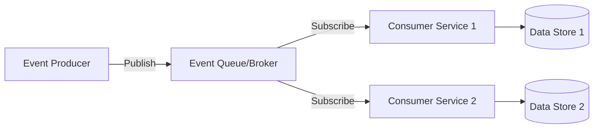
*Customize by: Changing producer/consumer types, adding dead letter queues, specifying event schemas*

**Template 3: Layered Architecture**
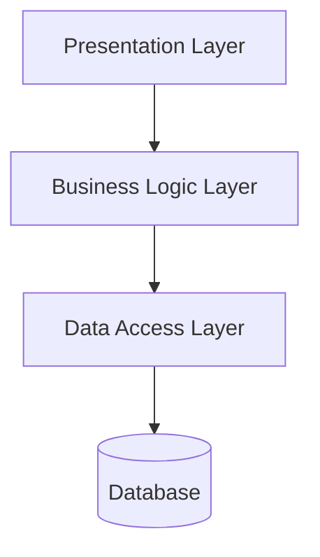
*Customize by: Adding caching layers, authentication middleware, external API integrations*

#### Diagram Best Practices

| Practice | Rationale |
|----------|-----------|
| Label all edges with action/event names | Clarifies what triggers transitions |
| Use consistent node naming across diagrams | Improves cross-reference comprehension |
| Highlight critical paths with styling | Draws attention to performance-sensitive flows |
| Keep diagrams focused (5-15 nodes max) | Prevents cognitive overload |
| Sequence diagrams should show failures | Documents error handling pathways |

### 3. Structured Tables for Precision

Tables provide scannable, precise specifications ideal for:

#### Responsibility Matrices (Universal Template)

**Copy-Paste Template**:
```markdown
| Component | Responsibility | Does NOT Handle |
|-----------|---------------|------------------|
| [Component A] | [Primary duty] | [Explicitly excluded concerns] |
| [Component B] | [Primary duty] | [Explicitly excluded concerns] |
| [Component C] | [Primary duty] | [Explicitly excluded concerns] |
```

**Example (Web Application)**:
```markdown
| Component | Responsibility | Does NOT Handle |
|-----------|---------------|------------------|
| AuthController | Validate credentials, issue JWT tokens | User profile management |
| UserService | Manage user CRUD operations, business logic | Authentication/authorization |
| EmailService | Send transactional emails, manage templates | Email validation |
| PaymentGateway | Process payment transactions | Order fulfillment |
```

**Example (Data Pipeline)**:
```markdown
| Component | Responsibility | Does NOT Handle |
|-----------|---------------|------------------|
| DataExtractor | Pull data from source systems via APIs | Data transformation |
| DataTransformer | Clean, normalize, enrich data | Data loading |
| DataLoader | Write transformed data to warehouse | Schema validation |
| OrchestrationEngine | Schedule pipeline runs, retry failures | Business logic |
```

#### Feature Status Tables (Universal Template)

**Copy-Paste Template**:
```markdown
| Feature | Status | Evidence/Location | Notes |
|---------|--------|-------------------|-------|
| [Feature Name] | ✅ Complete / ⚠️ Partial / ❌ Missing | [File path or proof] | [Implementation notes] |
```

**Example (Backend API)**:
```markdown
| Feature | Status | Evidence | Notes |
|---------|--------|----------|-------|
| User Registration | ✅ Complete | src/controllers/auth.ts | Email verification implemented |
| OAuth2 Integration | ⚠️ Partial | src/services/oauth.ts | Google only, Facebook pending |
| Rate Limiting | ✅ Complete | src/middleware/rate-limit.ts | Redis-backed, 100 req/min |
| API Versioning | ❌ Missing | — | Planned for Q2 |
```

**Example (Mobile App)**:
```markdown
| Feature | Status | Evidence | Notes |
|---------|--------|----------|-------|
| Offline Mode | ✅ Complete | src/offline/sync.dart | SQLite-based local storage |
| Push Notifications | ⚠️ Partial | src/services/push.dart | iOS only, Android pending |
| Biometric Auth | ✅ Complete | src/auth/biometric.dart | Face ID and Touch ID |
| Dark Mode | ❌ Missing | — | Deferred to v2.0 |
```

#### Decision Matrices

Document trade-off analysis:

```
| Approach | Pros | Cons | Verdict |
|----------|------|------|---------|
| Unified Snapshot Service | Single source of truth | Requires locking | ✅ Recommended |
| Synchronization Protocol | No shared state | Consistency complexity | ❌ Rejected |
```

### 4. Problem-First Organization

Every design document should open with clear problem articulation before presenting solutions.

#### Universal Problem Statement Template

**Copy-Paste Template**:
```markdown
## Overview

[2-3 sentence problem description]

### Current State

[Describe existing behavior and limitations]

**Specific Issues**:
- [Issue 1 with measurable impact]
- [Issue 2 with measurable impact]
- [Issue 3 with measurable impact]

### Root Cause Analysis

[Technical explanation of why the problem exists]

### Impact

**User Impact**:
- [How users are affected]
- [Quantified pain points: latency, errors, manual effort]

**Business Impact**:
- [Revenue/cost implications]
- [Technical debt consequences]

### Success Criteria

[Measurable outcomes that define success]
- [Metric 1: e.g., "Reduce API latency from 500ms to <100ms"]
- [Metric 2: e.g., "Achieve 99.9% uptime"]
- [Metric 3: e.g., "Zero data loss during failover"]
```

#### Example: API Performance Problem

```markdown
## Overview

The user dashboard API endpoint (/api/v1/dashboard) exhibits unacceptable latency, 
frequently exceeding 2 seconds under normal load, causing poor user experience and 
increased server costs.

### Current State

**Observed Behavior**:
- Average response time: 2.1 seconds (p50)
- 95th percentile: 4.5 seconds
- Timeout failures: 3% of requests
- Database query count per request: 47 queries

**Specific Issues**:
- N+1 query problem in user permissions check
- Lack of database connection pooling
- No caching layer for frequently accessed data
- Synchronous external API calls blocking response

### Root Cause Analysis

The endpoint performs sequential database queries for each user permission, project, 
and notification. The ORM generates individual SELECT statements instead of JOIN 
operations. External API calls to the notification service block the main thread.

### Impact

**User Impact**:
- 23% of users abandon dashboard load (analytics data)
- Customer satisfaction score dropped from 4.2 to 3.1
- Support tickets citing "slow performance" increased 300%

**Business Impact**:
- Estimated revenue loss: $50K/month from user churn
- Database costs increased 40% due to query volume
- Engineering team spending 15 hours/week on performance firefighting

### Success Criteria

- Reduce p50 response time to <200ms
- Reduce p95 response time to <500ms
- Reduce database queries per request from 47 to <5
- Achieve <1% timeout rate
- Decrease database load by 60%
```

## Section-by-Section Guide

### Overview Section

#### Purpose
Establish context, define scope, articulate the problem, and preview the solution strategy.

#### Required Elements

**Problem Definition**: 2-4 paragraphs describing:
- Current system behavior
- Identified deficiencies
- User impact or technical debt consequences

**Scope Boundaries**: Explicitly state what IS and IS NOT included:

```
**In Scope:**
- File-backed checkpoint persistence
- Writer state serialization
- Resume initialization logic

**Out of Scope:**
- Distributed checkpointing (future wave)
- Checkpoint compression (optimization candidate)
- Cloud storage backends (enterprise feature)
```

**Strategic Context** (if applicable):

```
### Wave 4 Context

This integration builds on Wave 4 audio runtime infrastructure:

| Component | Status | Relevant Files |
|-----------|--------|----------------|
| CPAL Backend | ✅ Implemented | runtime/src/backend/cpal.rs |
| CommandQueue | ✅ Implemented | runtime/src/messaging/queue.rs |
```

### Architecture Section

#### Purpose
Define system structure, component relationships, and design patterns.

#### Required Elements

**System Topology Diagram**:

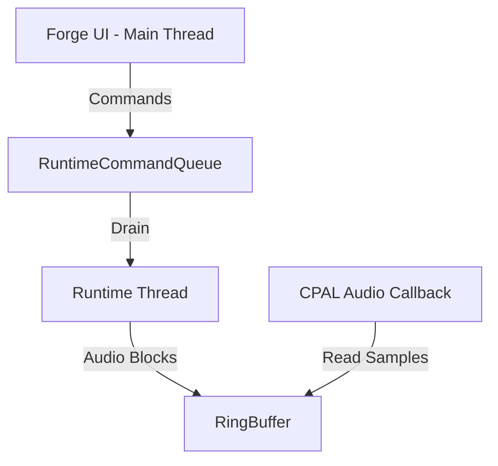

**Component Responsibility Matrix**:

| Component | Responsibility | Thread Context |
|-----------|---------------|----------------|
| GraphService | Apply diffs, publish revision commands | Handler thread |
| Runtime Thread | Drain commands, process audio, emit telemetry | Dedicated runtime thread |
| CPAL Backend | Hardware audio output | CPAL callback thread |

**Design Pattern Justification**:

Explain architectural choices:
- Why this structure vs alternatives
- How it addresses the stated problem
- What invariants it maintains

#### Best Practices

- Keep diagrams at the right abstraction level (5-12 components)
- Use consistent terminology across diagrams and tables
- Highlight critical boundaries (e.g., real-time thread boundaries)
- Reference existing architecture documents when applicable

### Data Flow Section

#### Purpose
Specify how information moves through the system, including normal and error paths.

#### Required Elements

**Primary Flow Diagram**:

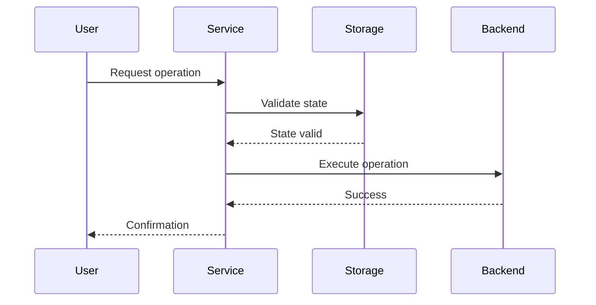

**Data Structure Schemas**:

Define key data formats using tables:

```
Checkpoint Snapshot Structure:

| Field | Type | Description |
|-------|------|-------------|
| job_id | OfflineRenderJobId | Identifier of job producing checkpoint |
| checkpoint_id | CheckpointId | Unique identifier for checkpoint instance |
| frames_processed | u64 | Total frames rendered across all blocks |
| writer_states | WriterResumeState[] | Per-writer resume metadata |
```

**State Transition Specifications**:

When the feature involves state machines, document transitions:

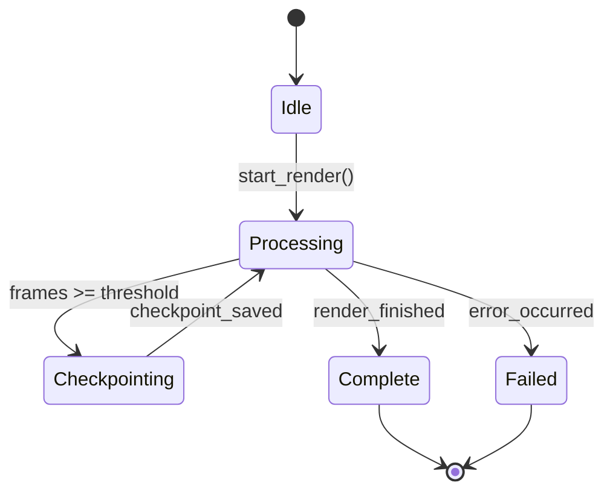

#### Best Practices

- Always show error paths in sequence diagrams
- Document message/event formats in tables
- Specify timeout behavior and retry logic
- Indicate synchronous vs asynchronous operations

### Implementation Phases Section

#### Purpose
Break the design into dependency-ordered execution phases with clear validation gates.

#### Required Structure

**Phase Table**:

| Phase | Objective | Dependencies | Validation |
|-------|-----------|--------------|------------|
| Phase 1 | Data model extensions | None | Serialization round-trip test passes |
| Phase 2 | File backend implementation | Phase 1 | Save/load integration test passes |
| Phase 3 | Writer state capture | Phase 2 | State export matches expected schema |
| Phase 4 | Resume initialization | Phase 3 | Resume produces identical output |

**Phase Detail Template**:

For each phase, provide:

**Objective**: One-sentence goal

**Changes**: Bulleted list of modifications by file/module

**Acceptance Criteria**: Specific, testable conditions

**Real-Time Considerations** (if applicable): Allocation/locking analysis

**Example**:

```
### Phase 2: File-Backed Persistence Backend

**Objective**: Implement CheckpointPersistence trait for disk I/O

**Changes**:
- Create runtime/src/offline/checkpoint/file_backend.rs module
- Implement FileCheckpointBackend structure
- Implement atomic write logic (temp file + rename)
- Register backend in OfflineRenderService::new

**Acceptance Criteria**:
- Backend saves snapshots to JSON files at expected paths
- Backend loads snapshots and validates format
- Corrupted files return descriptive errors
- Integration test demonstrates save/load cycle

**Real-Time Considerations**:
- All I/O operations occur off audio thread (worker thread context)
- No blocking calls in audio callback path
```

#### Best Practices

- Order phases by dependency (can't start Phase N+1 until Phase N complete)
- Each phase should be independently testable
- Avoid phases longer than 1 week of effort
- Include estimated effort for planning purposes

### Testing Strategy Section

#### Purpose
Define comprehensive validation approach ensuring correctness, performance, and robustness.

#### Required Elements

**Test Matrix**:

| Test Type | Scope | Coverage |
|-----------|-------|----------|
| Unit | Individual component behavior | Data structure serialization, state transitions |
| Integration | Cross-component workflows | End-to-end checkpoint save/load/resume |
| Regression | Prevent existing functionality breakage | All existing tests continue passing |
| Performance | Validate real-time budgets | Checkpoint I/O completes within deadline |

**Detailed Test Cases**:

For each critical scenario:

```
Test: Checkpoint Resume Produces Identical Output

Setup:
- Start render job with checkpoint_interval = 48000 frames
- Process 96000 frames (triggers one checkpoint)
- Terminate render

Execution:
- Resume from checkpoint
- Process remaining frames

Validation:
- Output file byte-identical to uninterrupted render
- Writer positions match expected values
- No discontinuities in audio data
```

**Acceptance Checklist**:

Provide boolean checklist for implementation completeness:

```
- [ ] All unit tests pass
- [ ] Integration tests cover happy path
- [ ] Error scenarios validated (corrupted checkpoint, missing files)
- [ ] Performance budgets validated via telemetry
- [ ] Regression suite passes (no existing tests broken)
- [ ] Manual testing procedure executed successfully
```

#### Best Practices

- Test error paths as thoroughly as happy paths
- Include performance validation for latency-sensitive features
- Specify manual testing procedures for UI/UX features
- Document pre-conditions and expected outcomes precisely

## Common Patterns and Anti-Patterns

### Patterns to Embrace

#### 1. Layered Architecture Description

Start with high-level topology, then zoom into each layer:

```
System Architecture (Top Level)
  ├─> UI Layer Details
  ├─> Service Layer Details
  ├─> Backend Layer Details
  └─> Storage Layer Details
```

#### 2. Dual-Path Documentation (Normal + Error)

Always document both success and failure scenarios:

```
Primary Flow: Command succeeds → State updates → Telemetry emitted
Error Flow: Command fails → Error logged → State remains unchanged → User notified
```

#### 3. Decision Rationale Capture

When choosing between alternatives, document the reasoning:

```
## Backend Registration Strategy

**Option A: Eager Initialization**
- Register backend during service construction
- Predictable failure modes
- ✅ Selected: Aligns with fail-fast philosophy

**Option B: Lazy Initialization**
- Register on first use
- Simpler for optional features
- ❌ Rejected: Hides configuration errors until runtime
```

#### 4. Constraint Declaration

Explicitly state what the design assumes or requires:

```
## Constraints

1. Manifest files must be present at runtime
2. Checkpoint directory must be writable
3. Audio thread cannot allocate memory
4. Command queue capacity fixed at initialization
```

### Anti-Patterns to Avoid

#### 1. Code Disguised as Design

**Bad**:
```
The function will check if (x > threshold) then return true
```

**Good**:
```
Validation Logic:

| Condition | Result |
|-----------|--------|
| Value exceeds threshold | Validation passes |
| Value at or below threshold | Validation fails with threshold error |
```

#### 2. Missing Error Handling

**Bad**: Only documenting the happy path

**Good**: Dedicated error handling section with recovery strategies

#### 3. Vague Acceptance Criteria

**Bad**: "System should work correctly"

**Good**: "Resume from checkpoint produces byte-identical output to uninterrupted render"

#### 4. Undefined Component Boundaries

**Bad**: "Service handles processing"

**Good**: Responsibility matrix clearly stating what each component does and doesn't do

#### 5. Premature Implementation Details

**Bad**: Specifying variable names, function signatures, or class hierarchies

**Good**: Describing component interfaces via API contract tables

## Automated Document Validation

### Linting and Quality Automation

To ensure design document completeness and consistency, implement automated validation tools that can be integrated into CI/CD pipelines or pre-commit hooks.

#### Document Linter Specification

**Purpose**: Automatically validate design documents against quality standards before review

**Validation Rules**:

| Rule ID | Check | Severity | Auto-Fix |
|---------|-------|----------|----------|
| **STRUCT-001** | Overview section exists | Error | No |
| **STRUCT-002** | Architecture section exists | Error | No |
| **STRUCT-003** | Testing Strategy section exists | Error | No |
| **STRUCT-004** | At least one Mermaid diagram present | Warning | No |
| **STRUCT-005** | Implementation phases defined | Error | No |
| **TABLE-001** | All tables have headers | Error | No |
| **TABLE-002** | Responsibility matrix has "Does NOT" column | Warning | No |
| **TABLE-003** | Feature status uses standard emojis (✅⚠️❌) | Warning | Yes |
| **DIAGRAM-001** | Mermaid diagrams have proper syntax | Error | No |
| **DIAGRAM-002** | Sequence diagrams show error paths | Warning | No |
| **ACCEPT-001** | Acceptance criteria defined | Error | No |
| **ACCEPT-002** | Acceptance criteria use checkboxes | Warning | Yes |
| **LINK-001** | No broken internal references | Error | No |
| **LENGTH-001** | Document under 1500 lines | Warning | No |
| **ANTI-001** | No code blocks (except Mermaid) | Error | No |
| **ANTI-002** | No language-specific syntax | Error | No |

#### Linter Implementation Approaches

**Approach 1: Markdown Parser + Custom Rules**

*Technology*: Python with `markdown-it-py` or JavaScript with `remark`

*Example Structure*:
```
# Pseudocode for document linter

function validateDesignDocument(filePath):
  ast = parseMarkdown(filePath)
  errors = []
  warnings = []
  
  # Structural checks
  if not hasSection(ast, "Overview"):
    errors.push("STRUCT-001: Missing Overview section")
  
  if not hasSection(ast, "Architecture"):
    errors.push("STRUCT-002: Missing Architecture section")
  
  # Diagram checks
  mermaidBlocks = findCodeBlocks(ast, language="mermaid")
  if mermaidBlocks.length == 0:
    warnings.push("STRUCT-004: No Mermaid diagrams found")
  
  for diagram in mermaidBlocks:
    if not validateMermaidSyntax(diagram.content):
      errors.push("DIAGRAM-001: Invalid Mermaid syntax at line {diagram.line}")
  
  # Anti-pattern checks
  codeBlocks = findCodeBlocks(ast, language != "mermaid")
  for block in codeBlocks:
    if containsCodePatterns(block.content):
      errors.push("ANTI-001: Code detected at line {block.line}")
  
  # Table checks
  tables = findTables(ast)
  for table in tables:
    if not hasTableHeader(table):
      errors.push("TABLE-001: Table missing header at line {table.line}")
  
  return {
    valid: errors.length == 0,
    errors: errors,
    warnings: warnings
  }
```

**Approach 2: Schema-Based Validation**

*Technology*: JSON Schema for metadata extraction + custom rules

*Workflow*:
1. Extract document structure to JSON representation
2. Validate against JSON schema defining required sections
3. Run custom validators for domain-specific rules

**Approach 3: RegEx-Based Quick Checks**

*Technology*: Shell script with grep/awk (lightest weight)

*Example Shell Script Pattern*:
```bash
#!/bin/bash
# design-doc-lint.sh

FILE=$1
ERRORS=0

# Check for required sections
if ! grep -q "^## Overview" "$FILE"; then
  echo "ERROR: Missing Overview section"
  ERRORS=$((ERRORS + 1))
fi

if ! grep -q "^## Architecture" "$FILE"; then
  echo "ERROR: Missing Architecture section"
  ERRORS=$((ERRORS + 1))
fi

# Check for Mermaid diagrams
if ! grep -q '```mermaid' "$FILE"; then
  echo "WARNING: No Mermaid diagrams found"
fi

# Check for code anti-patterns (simplified)
if grep -E '(struct |class |def |function |const )' "$FILE" | grep -v '```mermaid'; then
  echo "ERROR: Potential code syntax detected"
  ERRORS=$((ERRORS + 1))
fi

exit $ERRORS
```

#### CI/CD Integration

**GitHub Actions Example**:
```yaml
# .github/workflows/validate-design-docs.yml
name: Validate Design Documents

on:
  pull_request:
    paths:
      - 'docs/design/**/*.md'
      - '.qoder/quests/**/*.md'

jobs:
  lint-design-docs:
    runs-on: ubuntu-latest
    steps:
      - uses: actions/checkout@v3
      
      - name: Set up Python
        uses: actions/setup-python@v4
        with:
          python-version: '3.11'
      
      - name: Install dependencies
        run: |
          pip install markdown-it-py mermaid-validator
      
      - name: Lint design documents
        run: |
          python scripts/lint-design-docs.py docs/design/**/*.md
      
      - name: Check results
        if: failure()
        run: echo "Design document validation failed. See errors above."
```

**Pre-Commit Hook Example**:
```yaml
# .pre-commit-config.yaml
repos:
  - repo: local
    hooks:
      - id: design-doc-validator
        name: Validate Design Documents
        entry: scripts/design-doc-lint.sh
        language: script
        files: \.(md)$
        types: [markdown]
        pass_filenames: true
```

#### Automated Fixes

Some validation issues can be auto-corrected:

**Auto-Fix Examples**:

1. **Standardize Status Emojis**:
   - Find: `Status: Complete`
   - Replace: `Status: ✅ Complete`

2. **Convert Acceptance Criteria to Checkboxes**:
   - Find: `- All tests pass`
   - Replace: `- [ ] All tests pass`

3. **Format Tables**:
   - Auto-align table columns
   - Add missing separators

**Auto-Fix Script Pattern**:
```bash
# Auto-fix common issues
function autoFix(filePath):
  content = readFile(filePath)
  
  # Fix status emojis
  content = content.replace(/Status: Complete/g, 'Status: ✅ Complete')
  content = content.replace(/Status: Partial/g, 'Status: ⚠️ Partial')
  content = content.replace(/Status: Missing/g, 'Status: ❌ Missing')
  
  # Convert to checkboxes
  content = content.replace(/^- ([A-Z])/gm, '- [ ] $1')
  
  writeFile(filePath, content)
```

#### Validation Report Format

**Terminal Output Example**:
```
🔍 Validating design-new-feature.md...

✅ STRUCT-001: Overview section found
✅ STRUCT-002: Architecture section found
✅ STRUCT-003: Testing Strategy section found
⚠️  STRUCT-004: No Mermaid diagrams (add architecture diagram)
✅ STRUCT-005: Implementation phases defined
✅ TABLE-001: All tables have headers
✅ DIAGRAM-001: Mermaid syntax valid
⚠️  DIAGRAM-002: Sequence diagram missing error path (line 245)
✅ ACCEPT-001: Acceptance criteria defined
⚠️  LENGTH-001: Document is 1623 lines (recommend splitting)
✅ ANTI-001: No code blocks detected
✅ ANTI-002: No language-specific syntax

📊 Summary:
   Errors: 0
   Warnings: 3
   Status: ✅ PASS (warnings allowed)
```

**JSON Report Example** (for CI systems):
```json
{
  "file": "design-new-feature.md",
  "valid": true,
  "errors": [],
  "warnings": [
    {
      "rule": "STRUCT-004",
      "message": "No Mermaid diagrams found",
      "severity": "warning",
      "line": null
    },
    {
      "rule": "DIAGRAM-002",
      "message": "Sequence diagram missing error path",
      "severity": "warning",
      "line": 245
    },
    {
      "rule": "LENGTH-001",
      "message": "Document is 1623 lines (recommend splitting)",
      "severity": "warning",
      "line": null
    }
  ],
  "metrics": {
    "line_count": 1623,
    "diagram_count": 0,
    "table_count": 12,
    "section_count": 8
  }
}
```

#### Recommended Tooling Stack

| Use Case | Recommended Tool | Rationale |
|----------|------------------|------------|
| **Lightweight validation** | Shell script with grep/awk | No dependencies, fast, good for basic checks |
| **Comprehensive validation** | Python + markdown-it-py | Rich AST parsing, extensible, good error messages |
| **Mermaid syntax validation** | mermaid-cli (@mermaid-js/mermaid-cli) | Official validator, catches diagram errors |
| **Table formatting** | markdownlint-cli | Industry standard, auto-fix capable |
| **CI integration** | GitHub Actions / GitLab CI | Native markdown support, easy setup |
| **Pre-commit hooks** | pre-commit framework | Language-agnostic, composable |

#### Custom Rule Development

For project-specific requirements, extend the linter:

**Example: Domain-Specific Validation**
```
# Custom rule: Ensure performance section for real-time systems

function validatePerformanceSection(ast, metadata):
  if metadata.tags.includes("real-time"):
    if not hasSection(ast, "Performance Assessment"):
      return error("Real-time systems require Performance Assessment section")
  return pass()
```

**Example: Technology Stack Compliance**
```
# Custom rule: Validate approved technology mentions

APPROVED_TECHNOLOGIES = ["PostgreSQL", "Redis", "Kubernetes", "React"]
DEPRECATED_TECHNOLOGIES = ["MongoDB", "AngularJS"]

function validateTechnologyChoices(content):
  for tech in DEPRECATED_TECHNOLOGIES:
    if content.contains(tech):
      return warning(f"Deprecated technology '{tech}' mentioned. Consider alternatives.")
  return pass()
```

Use this checklist before finalizing any design document:

### Completeness

- [ ] Problem clearly articulated with current state analysis
- [ ] Scope explicitly bounded (in-scope and out-of-scope stated)
- [ ] Architecture section includes topology diagram
- [ ] Component responsibilities defined in table format
- [ ] Data flow documented via sequence/state diagrams
- [ ] Key data structures specified in schema tables
- [ ] Implementation broken into dependency-ordered phases
- [ ] Testing strategy with specific test cases defined
- [ ] Acceptance criteria clearly stated

### Clarity

- [ ] Document readable by someone unfamiliar with the codebase
- [ ] Mermaid diagrams render correctly
- [ ] Tables formatted consistently
- [ ] Technical terms defined on first use
- [ ] No code snippets (only natural language, tables, diagrams)
- [ ] Section headers form logical narrative flow

### Precision

- [ ] Component boundaries clearly delineated
- [ ] Error handling explicitly documented
- [ ] Performance implications analyzed (if applicable)
- [ ] Concurrency/threading context specified
- [ ] State ownership and lifecycle documented

### Actionability

- [ ] Implementation phases have clear objectives
- [ ] Dependencies between phases identified
- [ ] Validation gates defined for each phase
- [ ] Test scenarios specific and reproducible
- [ ] Acceptance criteria testable/measurable

### Maintainability

- [ ] Design decisions justified with rationale
- [ ] Alternative approaches documented with pros/cons
- [ ] Constraints and assumptions explicit
- [ ] References to related architecture docs included
- [ ] Risk assessment provided (if applicable)

## Template Library

### Ready-to-Use Document Templates

The following templates are **copy-paste ready** and can be customized for your specific project and domain.

---

### Template 1: Backend API Feature

```markdown
# [Feature Name] API Design

## Overview

[2-3 sentence description of the API feature and its purpose]

### Current State

[Describe existing API limitations or gaps]

### Success Criteria

- [Criterion 1: e.g., "Support 1000 requests/second"]
- [Criterion 2: e.g., "Respond within 100ms at p95"]
- [Criterion 3: e.g., "Maintain backward compatibility"]

## Architecture

### System Components

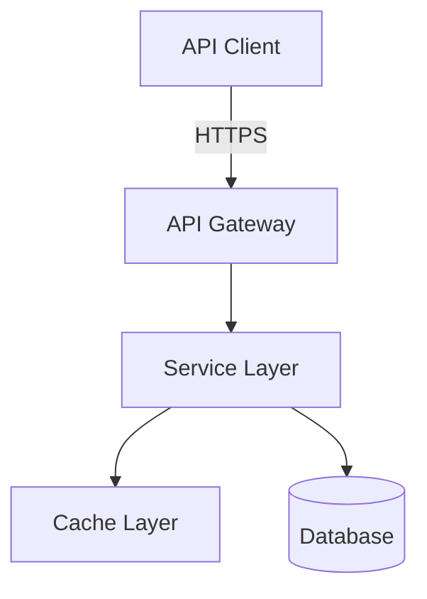

### Component Responsibilities

| Component | Responsibility | Does NOT Handle |
|-----------|---------------|------------------|
| API Gateway | Authentication, rate limiting, routing | Business logic |
| Service Layer | Business logic, validation, orchestration | Data persistence |
| Database | Data persistence, queries | Business rules |
| Cache Layer | Temporary data storage, read optimization | Data validation |

## API Specification

### Endpoint Definition

| Property | Value |
|----------|-------|
| Method | [GET/POST/PUT/DELETE] |
| Path | /api/v1/[resource] |
| Authentication | [Bearer token / API key / None] |
| Rate Limit | [requests per minute] |

### Request Schema

| Field | Type | Required | Validation | Description |
|-------|------|----------|------------|-------------|
| [field1] | String | Yes | Max 255 chars | [Description] |
| [field2] | Integer | No | Min: 0, Max: 100 | [Description] |
| [field3] | Object | Yes | See nested schema | [Description] |

### Response Schema

**Success (200 OK)**:

| Field | Type | Description |
|-------|------|-------------|
| [field1] | String | [Description] |
| [field2] | Array | [Description] |

**Error Responses**:

| Status Code | Scenario | Response Body |
|-------------|----------|---------------|
| 400 | Invalid input | `{"error": "validation_error", "details": [...]}` |
| 401 | Unauthorized | `{"error": "unauthorized"}` |
| 429 | Rate limit exceeded | `{"error": "rate_limit_exceeded", "retry_after": 60}` |
| 500 | Internal error | `{"error": "internal_server_error"}` |

## Data Flow

### Happy Path

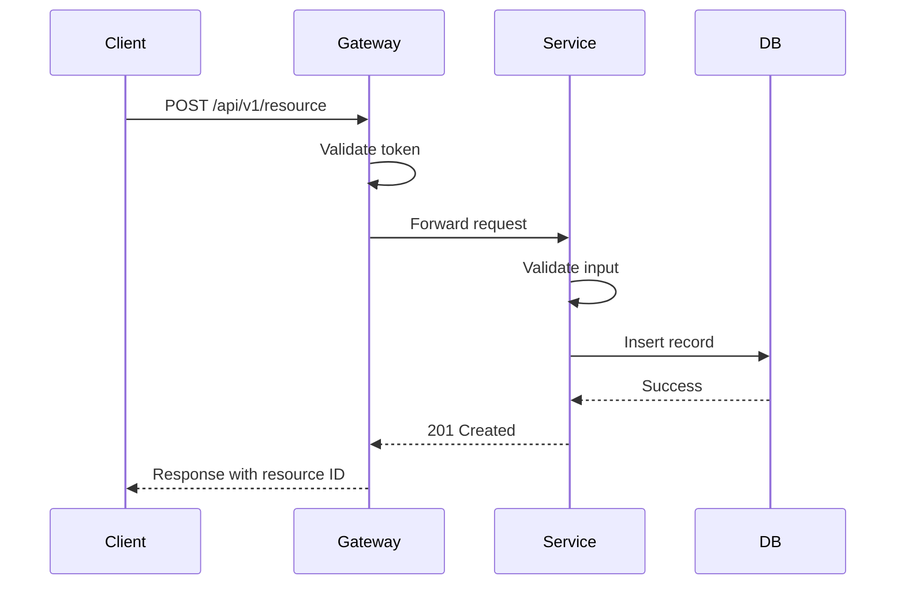

### Error Path

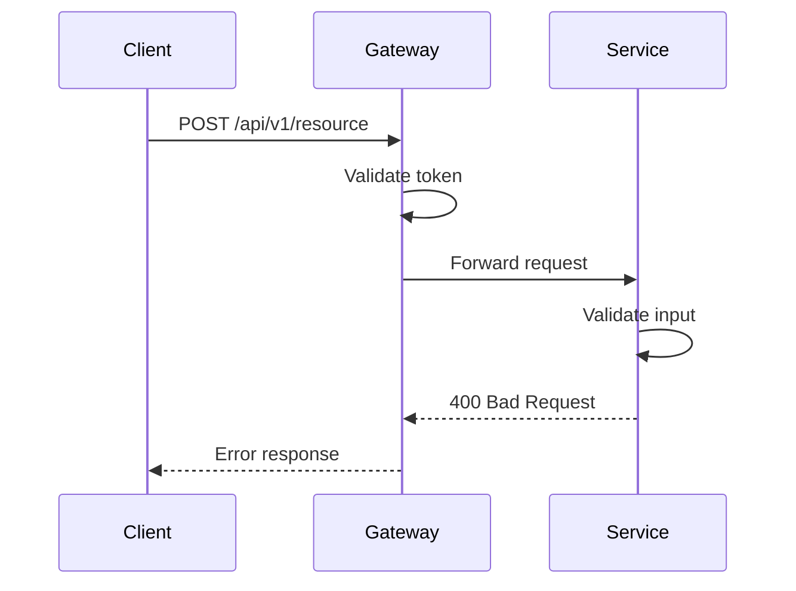

## Implementation Phases

### Phase 1: [Phase Name]

**Objective**: [One-sentence goal]

**Changes**:
- [Change 1]
- [Change 2]
- [Change 3]

**Acceptance Criteria**:
- [ ] [Criterion 1]
- [ ] [Criterion 2]
- [ ] [Criterion 3]

### Phase 2: [Phase Name]

**Objective**: [One-sentence goal]

**Changes**:
- [Change 1]
- [Change 2]

**Acceptance Criteria**:
- [ ] [Criterion 1]
- [ ] [Criterion 2]

## Testing Strategy

### Test Coverage

| Test Type | Coverage |
|-----------|----------|
| Unit Tests | Service layer validation, business logic |
| Integration Tests | End-to-end API flows, database interactions |
| Load Tests | 1000 req/s sustained, latency under 100ms |
| Security Tests | Authentication, authorization, input sanitization |

### Key Test Scenarios

**Scenario 1: Successful Resource Creation**
- **Setup**: Valid authentication token, valid input
- **Action**: POST /api/v1/resource with valid payload
- **Expected**: 201 Created, resource ID returned, record in database

**Scenario 2: Invalid Input Validation**
- **Setup**: Valid authentication, invalid field values
- **Action**: POST /api/v1/resource with invalid payload
- **Expected**: 400 Bad Request, validation errors listed

**Scenario 3: Rate Limit Enforcement**
- **Setup**: Exceed rate limit threshold
- **Action**: Send 101 requests in 1 minute
- **Expected**: 429 status on 101st request, retry-after header

## Error Handling

| Error Type | Handling Strategy |
|------------|-------------------|
| Validation errors | Return 400 with detailed field errors |
| Database connection failure | Return 503, retry with exponential backoff |
| External API timeout | Return 504, log for investigation |
| Unexpected exceptions | Return 500, log stack trace, alert on-call |

## Security Considerations

- [ ] Input sanitization implemented
- [ ] SQL injection prevention (parameterized queries)
- [ ] XSS prevention (output encoding)
- [ ] CSRF tokens for state-changing operations
- [ ] Rate limiting per API key
- [ ] Audit logging for sensitive operations

## Performance Targets

| Metric | Target | Measurement |
|--------|--------|-------------|
| Latency (p50) | <50ms | Application Performance Monitoring (APM) |
| Latency (p95) | <100ms | APM |
| Latency (p99) | <200ms | APM |
| Throughput | 1000 req/s | Load testing |
| Error rate | <0.1% | Error tracking service |
```

---

### Template 2: Frontend Component/Feature

```markdown
# [Component Name] Design

## Overview

[Brief description of the UI component and its purpose]

### Current State

[Describe existing UI limitations or gaps]

### Success Criteria

- [Criterion 1: e.g., "Render in <100ms"]
- [Criterion 2: e.g., "Accessible (WCAG 2.1 AA)"]
- [Criterion 3: e.g., "Mobile responsive"]

## Architecture

### Component Hierarchy

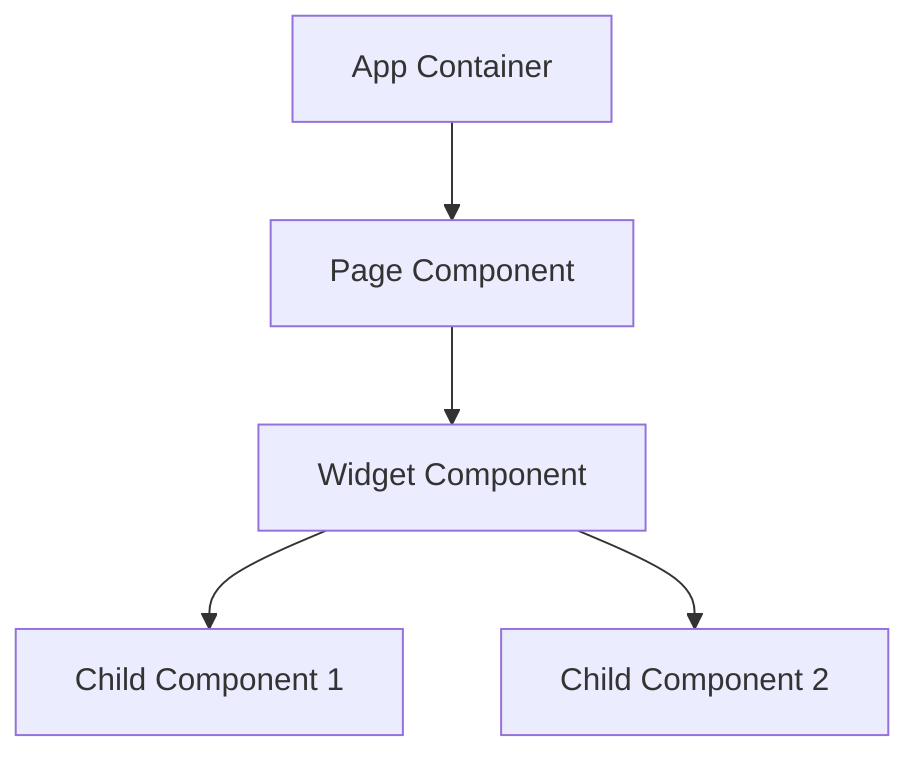

### Component Responsibilities

| Component | Responsibility | Does NOT Handle |
|-----------|---------------|------------------|
| [Component A] | [UI rendering, local state] | [API calls, business logic] |
| [Component B] | [Data fetching, state management] | [UI rendering details] |
| [Component C] | [Reusable UI element] | [Application state] |

## State Management

### State Structure

| State Property | Type | Source | Update Trigger |
|----------------|------|--------|----------------|
| [property1] | String | Component state | User input |
| [property2] | Array | Global store | API response |
| [property3] | Boolean | Props | Parent component |

### State Flow

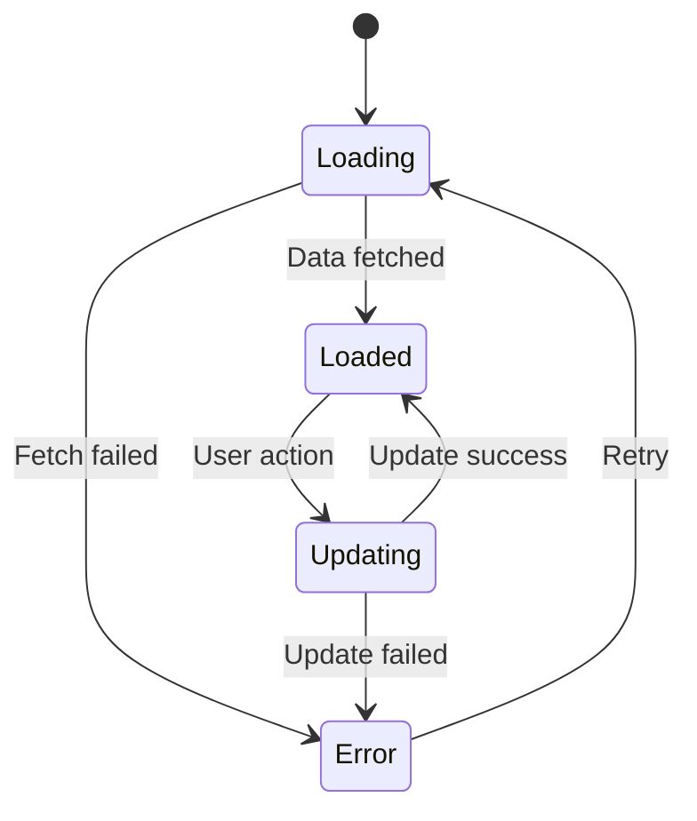

## User Interface

### Interaction Flow

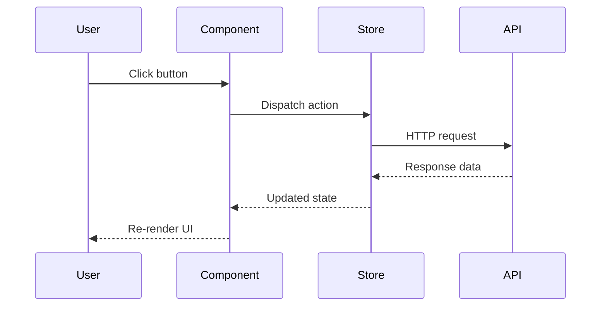

### Responsive Breakpoints

| Breakpoint | Width | Layout Behavior |
|------------|-------|------------------|
| Mobile | <768px | Single column, collapsed navigation |
| Tablet | 768px-1024px | Two columns, sidebar visible |
| Desktop | >1024px | Three columns, full navigation |

## Implementation Phases

### Phase 1: Component Structure

**Objective**: Build component skeleton and basic rendering

**Changes**:
- Create component file and exports
- Define prop interfaces
- Implement basic render function
- Add unit tests for rendering

**Acceptance Criteria**:
- [ ] Component renders without errors
- [ ] Props validated correctly
- [ ] Snapshot tests pass

### Phase 2: State Integration

**Objective**: Connect component to state management

**Changes**:
- Wire up state selectors
- Implement action dispatchers
- Add loading and error states

**Acceptance Criteria**:
- [ ] Component receives correct state
- [ ] Actions dispatched on user interaction
- [ ] Loading indicators display correctly

### Phase 3: Styling and Accessibility

**Objective**: Apply styles and ensure accessibility

**Changes**:
- Add CSS/styled-components
- Implement responsive breakpoints
- Add ARIA attributes
- Test keyboard navigation

**Acceptance Criteria**:
- [ ] Matches design mockups
- [ ] Responsive on all breakpoints
- [ ] WCAG 2.1 AA compliant
- [ ] Keyboard navigable

## Testing Strategy

### Test Coverage

| Test Type | Coverage |
|-----------|----------|
| Unit Tests | Component rendering, prop validation |
| Integration Tests | State updates, API integration |
| E2E Tests | User workflows, navigation |
| Accessibility Tests | Screen reader, keyboard navigation |
| Visual Regression | Screenshot comparison |

### Key Test Scenarios

**Scenario 1: Successful Data Load**
- **Setup**: Component mounted, API returns data
- **Action**: Component renders
- **Expected**: Data displayed, no error state

**Scenario 2: Error Handling**
- **Setup**: Component mounted, API returns error
- **Action**: Component renders
- **Expected**: Error message displayed, retry button visible

## Accessibility Checklist

- [ ] All interactive elements keyboard accessible
- [ ] ARIA labels on custom controls
- [ ] Color contrast ratio ≥4.5:1
- [ ] Focus indicators visible
- [ ] Screen reader tested
- [ ] Error messages announced
```

---

### Template 3: Database Schema Change

```markdown
# [Schema Change Name] Design

## Overview

[Description of the schema change and its purpose]

### Current Schema

[Describe current database structure]

### Success Criteria

- [Criterion 1: e.g., "Zero downtime migration"]
- [Criterion 2: e.g., "Backward compatible for 2 releases"]
- [Criterion 3: e.g., "Data integrity maintained"]

## Schema Design

### Entity Model

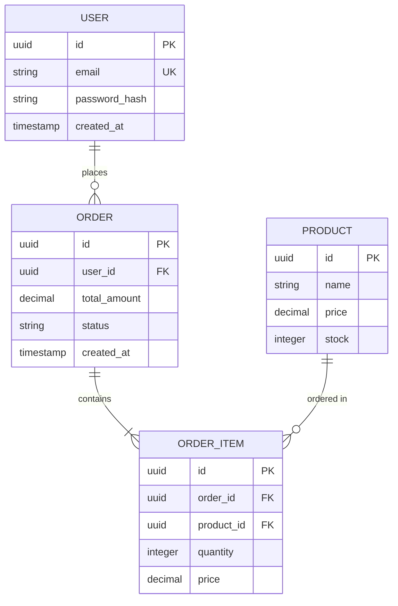

### Table Specifications

**Table: [table_name]**

| Column | Type | Constraints | Description |
|--------|------|-------------|-------------|
| id | UUID | PRIMARY KEY | Unique identifier |
| [column2] | VARCHAR(255) | NOT NULL, UNIQUE | [Description] |
| [column3] | INTEGER | DEFAULT 0, CHECK (>= 0) | [Description] |
| created_at | TIMESTAMP | NOT NULL, DEFAULT NOW() | Creation timestamp |
| updated_at | TIMESTAMP | NOT NULL | Last update timestamp |

**Indexes**:

| Index Name | Columns | Type | Purpose |
|------------|---------|------|----------|
| idx_[table]_[column] | [column] | B-tree | Fast lookups on [column] |
| idx_[table]_composite | [col1, col2] | B-tree | Compound queries |

## Migration Strategy

### Migration Phases

**Phase 1: Additive Changes**
- Add new columns with DEFAULT values
- Add new indexes concurrently
- Deploy application code supporting both old and new schema

**Phase 2: Data Migration**
- Backfill new columns from existing data
- Validate data integrity
- Monitor performance impact

**Phase 3: Cleanup**
- Remove old columns (after 2 release cycles)
- Drop deprecated indexes
- Update documentation

### Rollback Plan

| Phase | Rollback Action | Risk |
|-------|-----------------|------|
| Phase 1 | Drop new columns, application still works | Low |
| Phase 2 | Stop backfill, revert application | Medium |
| Phase 3 | Restore from backup | High |

## Data Migration Script

### Migration Overview

**Approach**: [Online / Offline / Hybrid]

**Estimated Duration**: [Time estimate]

**Data Volume**: [Number of rows affected]

**Migration Steps**:

1. **Pre-migration validation**
   - Backup database
   - Verify current data integrity
   - Check disk space availability

2. **Schema changes**
   - Execute DDL statements
   - Verify indexes created
   - Check query performance

3. **Data backfill**
   - Batch update existing records
   - Monitor lock contention
   - Validate data consistency

4. **Post-migration validation**
   - Run integrity checks
   - Compare row counts
   - Verify application functionality

## Testing Strategy

### Test Coverage

| Test Type | Coverage |
|-----------|----------|
| Schema Tests | Column types, constraints, indexes |
| Migration Tests | Dry-run on staging, data integrity |
| Performance Tests | Query latency before/after |
| Rollback Tests | Verify rollback procedures |

### Validation Queries

**Pre-Migration**:
- Row count validation
- Data distribution analysis
- Index usage statistics

**Post-Migration**:
- Data integrity checks (foreign keys, constraints)
- Performance regression testing
- Application smoke tests

## Performance Impact

| Metric | Before | After | Change |
|--------|--------|-------|--------|
| Query latency (p95) | [value] ms | [value] ms | [%] |
| Index size | [value] GB | [value] GB | [%] |
| Write throughput | [value] ops/s | [value] ops/s | [%] |

## Risk Assessment

| Risk | Likelihood | Impact | Mitigation |
|------|------------|--------|------------|
| Data loss during migration | Low | Critical | Full backup before migration |
| Performance degradation | Medium | High | Test on staging, monitor metrics |
| Application incompatibility | Low | High | Feature flags, gradual rollout |
| Long migration duration | Medium | Medium | Batch processing, off-peak execution |
```

---

### Template 4: Infrastructure/DevOps Change

```markdown
# [Infrastructure Change Name] Design

## Overview

[Description of the infrastructure change and its purpose]

### Current Infrastructure

[Describe existing setup]

### Success Criteria

- [Criterion 1: e.g., "Zero downtime deployment"]
- [Criterion 2: e.g., "Cost reduction of 30%"]
- [Criterion 3: e.g., "Auto-scaling working correctly"]

## Architecture

### Infrastructure Diagram

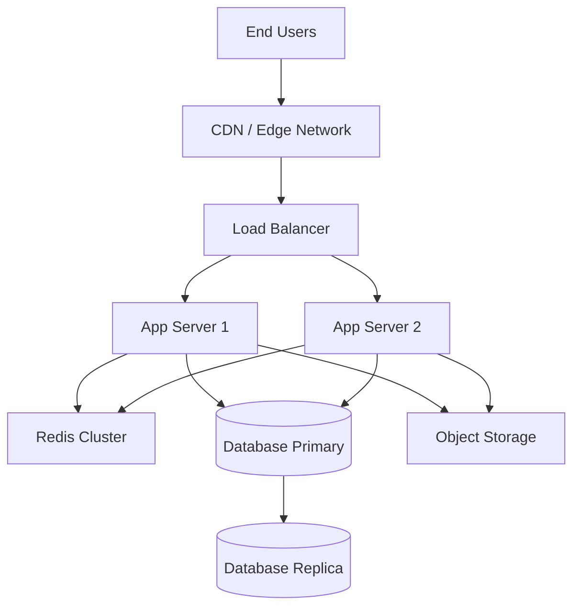

### Component Specifications

| Component | Type | Configuration | Purpose |
|-----------|------|---------------|----------|
| [Component] | [Instance type] | [CPU/RAM/Storage] | [Description] |

## Deployment Strategy

### Deployment Phases

**Phase 1: Infrastructure Provisioning**
- Provision new resources
- Configure networking
- Set up monitoring

**Phase 2: Application Deployment**
- Deploy application code
- Run database migrations
- Warm up caches

**Phase 3: Traffic Migration**
- Gradual traffic shift (10% -> 50% -> 100%)
- Monitor error rates and latency
- Rollback if issues detected

### Rollback Plan

- Shift traffic back to old infrastructure
- Preserve old infrastructure for 7 days
- Document lessons learned

## Configuration Management

### Environment Variables

| Variable | Purpose | Example Value |
|----------|---------|---------------|
| DATABASE_URL | Database connection string | postgresql://... |
| REDIS_URL | Cache connection string | redis://... |
| API_KEY | External service authentication | [secret] |

### Feature Flags

| Flag | Purpose | Default |
|------|---------|----------|
| enable_new_infrastructure | Toggle new infra | false |
| cache_enabled | Enable caching layer | true |

## Monitoring and Observability

### Metrics to Track

| Metric | Threshold | Alert |
|--------|-----------|-------|
| CPU utilization | >80% | Warning |
| Memory usage | >90% | Critical |
| Disk usage | >85% | Warning |
| Error rate | >1% | Critical |
| Response time (p95) | >500ms | Warning |

### Logging Strategy

- Centralized logging (e.g., ELK stack, CloudWatch)
- Structured JSON logs
- Log retention: 30 days
- Log sampling for high-volume endpoints

## Security Considerations

- [ ] Network segmentation (VPC, security groups)
- [ ] Encryption at rest and in transit
- [ ] Secrets management (e.g., AWS Secrets Manager)
- [ ] IAM roles and least privilege access
- [ ] Regular security audits
- [ ] Automated vulnerability scanning

## Cost Analysis

| Resource | Current Cost | Projected Cost | Change |
|----------|--------------|----------------|--------|
| Compute | $X/month | $Y/month | [-/+]% |
| Storage | $X/month | $Y/month | [-/+]% |
| Network | $X/month | $Y/month | [-/+]% |
| **Total** | **$X/month** | **$Y/month** | **[-/+]%** |

## Testing Strategy

- Load testing: Simulate production traffic
- Chaos engineering: Test failure scenarios
- Disaster recovery drills
- Cost validation: Monitor actual vs projected costs
```

---

### Minimal Template

For straightforward features:

```markdown
# [Feature Name] Design

## Overview
[Problem statement, scope, context]

## Architecture
[Component diagram, responsibility matrix]

## Data Flow
[Sequence diagram, state transitions]

## Implementation Phases
[Phase 1, Phase 2, ..., Phase N with validation]

## Testing Strategy
[Test matrix, key scenarios, acceptance criteria]
```

### Comprehensive Template

For complex, multi-component features:

```markdown
# [Feature Name] Design

## Overview
- Problem Definition
- Current State
- Gap Analysis
- Success Criteria
- Strategic Context (if applicable)

## Architecture
- System Topology
- Component Interaction Model
- Responsibility Matrix
- Design Pattern Justification

## Component Design
- Component A Details
- Component B Details
- Interface Contracts

## Data Flow
- Primary Flow Sequence
- Error Flow Sequence
- State Machine (if applicable)
- Data Structure Schemas

## Integration Strategy
- Initialization Sequence
- Lifecycle Management
- Inter-Component Protocols

## Implementation Phases
- Phase 1: [Objective]
- Phase 2: [Objective]
- ...
- Phase N: [Objective]

## Testing Strategy
- Test Matrix
- Unit Test Coverage
- Integration Test Scenarios
- Performance Validation (if applicable)
- Acceptance Checklist

## Error Handling Strategy
- Error Scenarios
- Recovery Mechanisms
- Observability/Logging

## Performance Considerations (if applicable)
- Real-Time Safety Analysis
- Allocation Points
- Latency Budget

## Risk Assessment (if applicable)
- Risk Matrix
- Mitigation Strategies

## Migration Strategy (if applicable)
- Breaking Changes
- Backward Compatibility
- Rollout Plan
```

## Domain-Specific Guidance

### Backend Systems

**Focus On**:
- API endpoint specifications (request/response schemas)
- Data model relationships (entity tables)
- Business logic architecture (service layer patterns)
- Middleware pipeline structure
- Authentication/authorization flow

**Critical Sections**:
- Error handling (HTTP status codes, error response formats)
- Validation rules (input constraints, business invariants)
- Transaction boundaries (ACID properties, rollback scenarios)

### Frontend Systems

**Focus On**:
- Component hierarchy (parent-child relationships)
- State management (global vs local, persistence)
- Routing structure (URL patterns, navigation flows)
- API integration layer (client contracts)
- UI responsiveness (breakpoints, layout behavior)

**Critical Sections**:
- Props/state/lifecycle documentation
- Event handling flows
- Accessibility considerations

### Real-Time Systems

**Focus On**:
- Thread boundaries (which operations on which threads)
- Allocation analysis (where memory is allocated)
- Locking strategy (lock-free vs synchronized)
- Latency budgets (time constraints per operation)
- Telemetry emission (non-blocking observability)

**Critical Sections**:
- Real-time safety analysis
- Performance budgets
- Backpressure handling
- Underrun/overrun recovery

### Libraries/Frameworks

**Focus On**:
- Public API surface (exported interfaces)
- Extension points (plugin mechanisms)
- Integration examples (common usage patterns)
- Version compatibility (semver implications)
- Performance characteristics (complexity analysis)

**Critical Sections**:
- API contract specifications
- Configuration schema
- Error propagation model

## Document Evolution and Iteration

### When to Update Design Documents

Design documents are living artifacts that should evolve with the system:

**Update Triggers**:
- Architectural changes during implementation
- Discovery of missing edge cases
- Performance requirement adjustments
- Scope expansions (with appropriate review)
- Post-implementation learnings

**Update Process**:
1. Identify section requiring modification
2. Update affected diagrams/tables/descriptions
3. Mark changes with version notes or changelog
4. Re-review updated sections with stakeholders
5. Ensure test strategy reflects new design

### Design Review Process

**Pre-Review Checklist**:
- Quality checklist above completed
- All diagrams render correctly
- Tables formatted consistently
- No placeholder sections (all TBD removed or justified)

**Review Focus Areas**:
- Architectural soundness (does it solve the problem?)
- Completeness (are critical scenarios covered?)
- Feasibility (can it be implemented as described?)
- Maintainability (is the design sustainable long-term?)
- Performance (does it meet non-functional requirements?)

## Advanced Techniques

### Comparative Analysis Tables

When presenting multiple solutions:

```
| Criterion | Approach A | Approach B | Approach C |
|-----------|------------|------------|------------|
| Complexity | Low | Medium | High |
| Performance | Good | Excellent | Fair |
| Maintainability | High | Medium | Low |
| Risk | Low | Medium | High |
| **Verdict** | ✅ Recommended | Alternative | ❌ Rejected |
```

### Traceability Matrices

Link requirements to design elements:

```
| Requirement | Addressed By | Validation Method |
|-------------|--------------|-------------------|
| REQ-001: Audio playback | Runtime event loop, CPAL backend | Integration test: audio_output_produces_signal |
| REQ-002: Real-time safety | Lock-free queue, preallocated buffers | Performance test: zero_allocations_on_audio_thread |
```

### Dependency Graphs

Visualize implementation order:

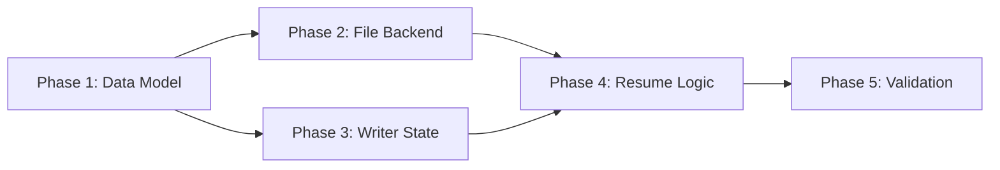

## Quick Start Guide

### Getting Started with Templates

**Step 1: Choose the Right Template**

Match your feature type to a template:

| Your Feature Type | Use Template | Key Focus Areas |
|-------------------|--------------|------------------|
| REST API endpoint | Backend API Feature | Request/response schemas, error handling |
| GraphQL resolver | Backend API Feature (adapted) | Schema definitions, resolver chains |
| React component | Frontend Component | State management, responsive design |
| Database migration | Database Schema Change | Migration safety, rollback plan |
| Kubernetes deployment | Infrastructure Change | Scaling, monitoring, cost |
| Batch job | Backend API Feature (adapted) | Scheduling, idempotency |
| Authentication system | Backend API Feature + Security | Token management, session handling |
| File upload | Backend API Feature + Infrastructure | Storage, chunking, validation |

**Step 2: Copy Template to Your Project**

```bash
# Create design docs directory if it doesn't exist
mkdir -p docs/design

# Copy template (example)
cp quest-planning-guide.md docs/design/my-new-feature.md

# Open in editor
code docs/design/my-new-feature.md
```

**Step 3: Fill In Placeholders**

Replace all bracketed placeholders:
- `[Feature Name]` → Your feature name
- `[Description]` → Specific descriptions
- `[Component A]` → Actual component names
- `[table_name]` → Database table names
- `[value]` → Real values/metrics

**Step 4: Customize Diagrams**

Update Mermaid diagrams with your architecture:
1. Change node names to match your components
2. Add/remove connections based on your data flow
3. Add styling for critical paths (if needed)

**Step 5: Validate Before Review**

```bash
# Run linter (if configured)
./scripts/lint-design-doc.sh docs/design/my-new-feature.md

# Manual checklist
- [ ] All placeholders replaced
- [ ] Diagrams render correctly
- [ ] Tables formatted consistently
- [ ] No code syntax included
- [ ] Acceptance criteria defined
```

---

## Quick Reference Guide

### Common Section Patterns

#### Component Responsibility Pattern
```markdown
| Component | Responsibility | Does NOT Handle |
|-----------|---------------|------------------|
| [Name] | [What it does] | [What it doesn't do] |
```

#### Decision Rationale Pattern
```markdown
## [Decision Topic]

**Options Considered**:

| Option | Pros | Cons | Verdict |
|--------|------|------|----------|
| A | [Advantages] | [Disadvantages] | ✅ Selected |
| B | [Advantages] | [Disadvantages] | ❌ Rejected |

**Rationale**: [Why Option A was chosen over Option B]
```

#### Error Handling Pattern
```markdown
## Error Handling

| Error Type | Detection | Handling | User Impact |
|------------|-----------|----------|-------------|
| [Error] | [How detected] | [Recovery strategy] | [What user sees] |
```

#### Phase Implementation Pattern
```markdown
### Phase [N]: [Phase Name]

**Objective**: [One-sentence goal]

**Dependencies**: [Phase N-1, External System X]

**Changes**:
- [Change 1 with file/module reference]
- [Change 2]

**Acceptance Criteria**:
- [ ] [Testable criterion 1]
- [ ] [Testable criterion 2]

**Estimated Effort**: [Time estimate]
```

### Mermaid Diagram Cheat Sheet

#### Sequence Diagram Syntax
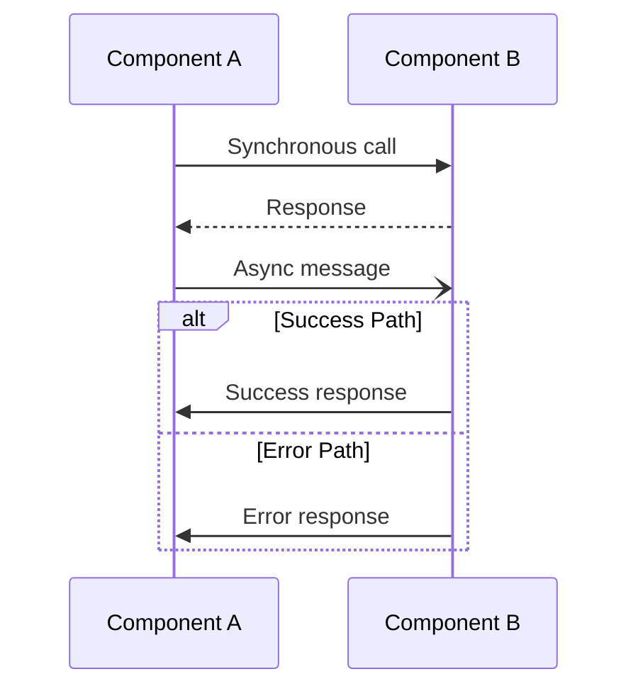

#### State Diagram Syntax
```mermaid
stateDiagram-v2
    [*] --> StateA
    StateA --> StateB: Transition label
    StateB --> StateC: Another transition
    
    state StateB {
        [*] --> SubState1
        SubState1 --> SubState2
    }
    
    StateC --> [*]
```

#### Architecture Diagram Syntax
```mermaid
graph LR
    A[Component A] -->|Label| B[Component B]
    B --> C{Decision}
    C -->|Yes| D[Path 1]
    C -->|No| E[Path 2]
    
    style A fill:#f9f,stroke:#333
    style D fill:#bfb,stroke:#333
```

### Status Emoji Reference

| Emoji | Meaning | When to Use |
|-------|---------|-------------|
| ✅ | Complete | Feature fully implemented and tested |
| ⚠️ | Partial | Feature partially implemented, gaps remain |
| ❌ | Missing | Feature not yet started or blocked |
| 🚧 | In Progress | Feature actively being developed |
| 🔄 | Under Review | Feature complete, awaiting review |
| ⏸️ | Paused | Development temporarily halted |
| 📋 | Planned | Feature documented, not yet scheduled |

### Validation Checklist (Printable)

```
□ Document Structure
  □ Overview section exists
  □ Architecture section exists  
  □ Data Flow section exists
  □ Implementation Phases defined
  □ Testing Strategy defined

□ Content Quality
  □ Problem clearly stated
  □ Success criteria measurable
  □ Component boundaries defined
  □ Error handling documented
  □ No code syntax (only tables/diagrams/prose)

□ Visual Elements
  □ At least one Mermaid diagram
  □ Diagrams render without errors
  □ All tables have headers
  □ Consistent formatting throughout

□ Completeness
  □ All placeholders replaced
  □ Dependencies identified
  □ Acceptance criteria use checkboxes
  □ Risk assessment included (if complex)
  □ Migration plan included (if replacing system)

□ Review Ready
  □ Spell-checked
  □ Links validated
  □ Technical review requested
  □ Stakeholders identified
```

---

## Advanced Techniques

### Cross-Referencing Documents

When features span multiple documents:

```markdown
## Related Designs

This design builds on:
- [Authentication System](./auth-system.md) - Provides user identity
- [Database Schema v2](./database-schema-v2.md) - Defines data model

This design is referenced by:
- [Admin Dashboard](./admin-dashboard.md) - Consumes this API
```

### Version History Tracking

Add version notes for significant updates:

```markdown
## Document History

| Version | Date | Author | Changes |
|---------|------|--------|----------|
| 1.0 | 2024-01-15 | Alice | Initial design |
| 1.1 | 2024-01-20 | Bob | Added error handling section |
| 2.0 | 2024-02-01 | Alice | Revised based on review feedback |
```

### Stakeholder Matrix

For complex features, identify stakeholders:

```markdown
## Stakeholders

| Stakeholder | Role | Involvement |
|-------------|------|-------------|
| Product Team | Requirements owner | Approve scope and UX |
| Engineering Team | Implementation | Technical review, implementation |
| DevOps Team | Infrastructure | Review deployment strategy |
| Security Team | Security review | Approve authentication design |
```

### Glossary Section

For domain-specific terminology:

```markdown
## Glossary

| Term | Definition |
|------|------------|
| JWT | JSON Web Token - Compact token format for authentication |
| RBAC | Role-Based Access Control - Permission model |
| CQRS | Command Query Responsibility Segregation - Architectural pattern |
```

## Final Recommendations

### Adoption Strategy

**For Individual Contributors**:
1. Start with the minimal template for simple features
2. Graduate to comprehensive template for complex systems
3. Build a personal template library for recurring patterns
4. Share successful designs as examples for team

**For Teams**:
1. **Week 1-2**: Introduce guide in team meeting, discuss benefits
2. **Week 3-4**: Pilot with one feature, gather feedback
3. **Week 5-6**: Refine templates based on team needs
4. **Week 7+**: Make design docs mandatory for new features
5. **Ongoing**: Review and update templates quarterly

**For Organizations**:
1. Create central design doc repository
2. Set up automated linting in CI/CD
3. Include design review in PR checklist
4. Track design quality metrics (completeness, clarity)
5. Celebrate good design docs in team retrospectives

### Integration with Development Workflow

```mermaid
flowchart LR
    A[Feature Request] --> B[Create Design Doc]
    B --> C[Technical Review]
    C --> D{Approved?}
    D -->|No| B
    D -->|Yes| E[Implementation]
    E --> F[Testing]
    F --> G[Code Review]
    G --> H{Matches Design?}
    H -->|No| I[Update Design or Code]
    H -->|Yes| J[Merge]
    I --> G
    J --> K[Deploy]
```

### Document Length Guidelines

| Feature Complexity | Target Length | Max Length |
|--------------------|---------------|------------|
| **Simple** (bug fix, minor enhancement) | 300-500 lines | 600 lines |
| **Medium** (new component, API endpoint) | 500-800 lines | 1000 lines |
| **Complex** (system redesign, architecture change) | 800-1200 lines | 1500 lines |
| **Very Complex** (multi-system integration) | Split into multiple docs | 1500 lines each |

**Rule of Thumb**: If you exceed max length, split into:
- Overview document (high-level architecture)
- Component-specific documents (detailed designs)

### Continuous Improvement

**Quarterly Review Checklist**:
- [ ] Review completed design docs vs. actual implementation
- [ ] Identify common patterns (add to template library)
- [ ] Update validation rules based on recurring issues
- [ ] Collect team feedback on template usability
- [ ] Update examples with recent successful designs
- [ ] Revise domain-specific sections as tech stack evolves

### Metrics for Success

**Document Quality Metrics**:
- % of features with design docs (target: 100% for medium+ complexity)
- Average time from design approval to implementation start (should decrease)
- % of implementations matching design (target: >90%)
- Design doc completeness score (from linter, target: >95%)

**Team Velocity Metrics**:
- Reduced implementation bugs (design catches issues earlier)
- Faster onboarding (new team members read designs)
- Improved code review efficiency (reviewers reference design)
- Better cross-team collaboration (shared understanding)

### Common Pitfalls to Avoid

| Pitfall | Warning Sign | Solution |
|---------|--------------|----------|
| **Over-engineering** | Design is longer than implementation | Focus on high-level architecture, not every detail |
| **Analysis paralysis** | Design never finishes | Set time-box (2-3 days max), iterate later |
| **Stale designs** | Implementation diverges significantly | Update design during development |
| **Copy-paste errors** | Generic placeholders remain | Use linter to catch [placeholder] text |
| **No stakeholder buy-in** | Design approved but never implemented | Include stakeholders early, get explicit approval |
| **Premature optimization** | Design assumes scale not yet needed | Design for current needs + 1 order of magnitude |

### Resources and Tools

**Recommended Tools**:
- **Markdown Editor**: VSCode with Markdown Preview Enhanced extension
- **Diagram Tool**: Mermaid Live Editor (https://mermaid.live) for testing diagrams
- **Linter**: Custom script (see Automated Validation section) or markdownlint
- **Version Control**: Git (treat design docs like code)
- **Review Platform**: GitHub/GitLab pull requests with required approvals

**Learning Resources**:
- Software Architecture: The Hard Parts (book)
- C4 Model for software architecture (c4model.com)
- AWS Well-Architected Framework (for cloud systems)
- 12 Factor App (for web services)

### Template Customization Guide

Adapt templates to your organization:

**Customization Checklist**:
- [ ] Replace generic component names with your system's terminology
- [ ] Add company-specific sections (e.g., compliance, cost approval)
- [ ] Adjust diagram styles to match company branding
- [ ] Include links to internal architecture docs
- [ ] Add domain-specific validation rules to linter
- [ ] Create examples from past successful projects

**Example Customizations**:
- **E-commerce**: Add "Payment Security" mandatory section
- **Healthcare**: Add "HIPAA Compliance" checklist
- **FinTech**: Add "Financial Audit Trail" requirements
- **Gaming**: Add "Performance Budget" with FPS targets
- **IoT**: Add "Device Compatibility Matrix"

---

## Conclusion

High-quality design documents are the foundation of maintainable, well-architected software systems. By following this guide:

**You will achieve**:
- ✅ Consistent documentation across projects and teams
- ✅ Faster implementation with fewer surprises
- ✅ Better stakeholder alignment and fewer miscommunications
- ✅ Improved code review quality (reviewers can reference design)
- ✅ Easier onboarding for new team members
- ✅ Reduced technical debt (design catches issues early)

**Remember**:
- **Start simple**: Use minimal template, add sections as needed
- **Iterate**: Design docs evolve with implementation
- **Validate**: Use automated linting to maintain quality
- **Share**: Build a library of successful designs for reference
- **Review**: Designs are as important as code reviews

**Next Steps**:
1. Choose a template from the Template Library section
2. Copy it to your project's design docs directory  
3. Fill in placeholders with your feature details
4. Run validation checklist
5. Submit for technical review
6. Iterate based on feedback
7. Keep design updated during implementation

**Happy designing! 🏛️**

---

*This guide is a living document. Contributions, feedback, and improvements are welcome.*
